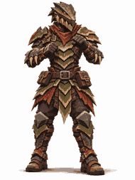

# Wildhaven — Set Garruva v01

> **Status:** CONCEITO 2D / AGUARDANDO APROVAÇÃO ARTÍSTICA DO DIRETOR. **Não é render de GLB**, não há malhas, rig, skin, animações, LODs ou integração na Alpha.

A imagem no GitHub é uma **prévia PNG real de 190 × 253 px (10.238 bytes)**, compactada para transporte pelo conector. A arte original de **1087 × 1446 px**, apresentada na conversa do ChatGPT, mantém a resolução de referência; **não está incluída nesta branch**. Esta prévia não deve ser anunciada como render do Hunter oficial ou do Garruva GLB. Na fase de modelagem, a proporção e a instalação no rig oficial do Hunter precisam de validação.

## Identidade do conjunto

- **Nome:** Set Garruva — Armadura do Necrófago.
- **Criatura de origem:** Garruva v03, **réptil terrestre necrófago**; a antiga interpretação como ave foi descartada.
- **Bioma:** fauna terrestre; **bioma preciso a confirmar** na ficha ecológica — a documentação técnica do piloto v03 não fixa um bioma exclusivo.
- **Direção estética:** armadura original do Wildhaven, inspirada na linguagem dos conjuntos de caça de Monster Hunter, traduzida em silhueta low-poly de planos facetados.
- **Hunter:** silhueta masculina low-poly em postura de guarda, seguindo o modelo visual aprovado. A ilustração **não é projeção de textura nem edição de uma captura GLB**; encaixe exato com o esqueleto oficial é etapa futura.

## Anatomia confirmada e adaptação

Referências verificadas no README, manifesto e gerador de Garruva v03: crânio comprido em cunha, mandíbula forte, dentes cortantes, olhos âmbar em cavidades, garganta ferrugem, quatro membros com garras, dorso de escudos baixos integrados e cauda longa como contrapeso. **Sem penas, asas ou chifres naturais.** A máscara é uma evocação esculpida do focinho e da linha dentada; não transforma a cabeça do animal em parte anatômica humana, nem adiciona chifres.

## Peças da armadura

| Peça | Proposta visual |
|---|---|
| **Capacete/máscara** | Elmo fechado com testa angulosa, focinho alongado facetado, visor âmbar estreito e bordas inferiores em dentes ósseos; perfil muito diferente do Talvero, Rambrél e Turvagal. |
| **Peitoral** | Couraça de placas sobrepostas como os escudos dorsais baixos do Garruva, com reforço de couro sob a placa central. |
| **Ombreiras** | Placas de escamas oliva/ocre, com silhueta baixa e articulação nos deltoides; bordas gastas e ferragens escuras. |
| **Manoplas** | Luvas e braçadeiras rígidas, garras decorativas pequenas alinhadas aos punhos, sem travar os dedos ou ampliar artificialmente as mãos. |
| **Cinturão** | Bolsas de caça, fivela robusta e correias com presilhas. |
| **Proteção das pernas** | Painéis segmentados descendo da cintura, inspirados no afilamento da cauda, com liberação do quadril, joelho e entrepernas. |
| **Grevas/botas** | Caneleiras de placas angulares, joelheiras geométricas e botas fechadas de sola reforçada. |

## Materiais conceituais

Couro curtido, escamas e placas córneas *inspiradas* na pele do Garruva, dentes/garras como detalhes controlados, placas metálicas pequenas, tecido ferrugem e correias. Não há confirmação de rendimento de materiais, receita de crafting ou quais partes podem ser obtidas da espécie no jogo.

**Paleta:** corpo oliva/charcoal (#47483D, #34342F), placas cáqui (#77705A), tons de osso (#D7BD91) e ferrugem no pescoço (#874D3D), derivados da paleta do gerador da criatura. Variações de cor devem ser resolvidas em textura UV na futura versão GLB, sem malhas extras para manchas.

## Raridade e atributos (não oficiais)

**Raridade:** a definir; *proposta* de categoria intermediária, sem aprovação. **Atributos:** nenhuma estatística definida. **Ideia de função:** conjunto de caçador versátil para incursões terrestres, sem bônus concretos de defesa, mobilidade ou resistência até decisão de design.

## Referências consultadas

- [AGENTS.md (regras do projeto)](https://github.com/carioca1111/wildhaven-new/blob/main/AGENTS.md)
- [Oficina do Hunter](https://github.com/carioca1111/wildhaven-new/blob/main/assets/hunters/hunter-workshop/README.md)
- [Garruva v03 — documentação anatômica](https://github.com/carioca1111/wildhaven-new/blob/main/assets/models/creatures/garruva-v03-pilot/README.md)
- [Garruva v03 — manifesto GLB](https://github.com/carioca1111/wildhaven-new/blob/main/assets/models/creatures/garruva-v03-pilot/manifest.json)
- [Garruva v03 — gerador/paleta](https://github.com/carioca1111/wildhaven-new/blob/main/assets/models/creatures/garruva-v03-pilot/source/build.py)
- [Garruva v03 — GLB de referência, não embutido neste conceito](https://github.com/carioca1111/wildhaven-new/blob/main/assets/models/creatures/garruva-v03-pilot/garruva-v03-anatomy-blockout.glb)
- [PR #44 do Garruva no Wildhaven original](https://github.com/carioca1111/wildhaven/pull/44)
- [Exemplos de linguagem facetada](https://github.com/carioca1111/wildhaven-new/blob/main/docs/prompts/referencias/exemplos-criaturas-v03.md)

**Limite da verificação:** referências de espécie foram consultadas em README, manifesto, código-fonte, referências de renders e existência do GLB no repositório. O GLB não foi importado localmente nem seu SHA-256 recalculado nesta entrega. O piloto registra revisão artística pendente.

## Controle de aprovação

- [x] Conferir repositórios, AGENTS e documentação do Hunter.
- [x] Verificar ausência de conjunto Garruva nos PRs consultados; Talvero e Turvagal têm PRs de conceito, Rambrél já teve arte nesta conversa.
- [x] Criar arte individual com máscara e conjunto completo.
- [x] Publicar PNG de prévia, README e manifesto em branch de trabalho independente.
- [ ] Aprovação artística explícita do diretor.
- [ ] Vistas adicionais, e opcionalmente PNG mestre em alta resolução no GitHub.
- [ ] Modelagem **GLB real** sobre Hunter oficial (somente após aprovação).
- [ ] Três renders **reais do GLB** para aprovação da forma.
- [ ] Refinamento, UVs e texturas após aprovação.
- [ ] Rig, skinning e animações após aprovação.
- [ ] Filtro de Qualidade e futura integração, cada qual com validação independente.

**Não modificar Alpha, modelos aprovados ou outras armaduras. Não fazer merge automático.**
