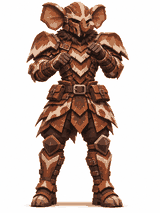

# Wildhaven — Set Mastélio v01 · Armadura do Guardião da Savana

**STATUS: CONCEITO / AGUARDANDO APROVAÇÃO DO DIRETOR.** Ilustração artística 2D — **não** é um GLB ou render técnico de um GLB. Nenhum equipamento foi integrado à Alpha.

**Limite da publicação:** o PNG neste PR é uma **prévia de 160 × 213 pixels** e paleta simplificada para transferência pelo conector. O **PNG mestre original (1088 × 1446 px)** está disponível nesta conversa, mas não foi publicado no repositório. Não apresentar a miniatura como arquivo mestre.

## Origem e anatomia verificada

- **Criatura-base:** Mastélio, grande frugívoro herbívoro da **savana**.
- **Modelo referenciado:** Mastélio v03-pilot, **GLB de blockout em revisão artística**, cujo conceito da criatura foi documentado como aprovado.
- **Características confirmadas:** cabeça de mandíbula larga, duas orelhas grandes em leque com face interna, tromba **curta, preênsil e curvada para cima**, topete, pescoço com pelagem em camadas, corpo de grandes planos facetados, manchas claras e membros colunares com unhas.
- **Não inventar:** presas de marfim/trombas longas, chifres ou garras de predador inexistentes na anatomia documentada.
- **Linguagem:** armadura original do Wildhaven inspirada na leitura de equipamentos de caça de Monster Hunter, com arestas firmes, silhueta reconhecível e encaixe humano plausível.

## Partes do conjunto

| Parte | Design da armadura |
|---|---|
| **Capacete / máscara** | Máscara de rosto integral, visor escuro horizontal, guarda nasal de **tromba curta voltada para cima**. Dois protetores laterais se abrem em leque como as orelhas do Mastélio. São placas de equipamento, não anatomia adicional da espécie. |
| **Peitoral** | Couraça torácica robusta de faixas castanhas e creme em planos de V, placas moderadas e subcamada de couro. |
| **Ombreiras** | Protetores largos, segmentados, com bordas creme, não conectados rigidamente ao capacete para liberar os braços. |
| **Manoplas** | Luvas de couro articuladas com reforços nos punhos e placas facetadas nos antebraços. |
| **Cinturão** | Fivela central, alforjes laterais, tiras e saias móveis de couro. |
| **Proteção das pernas** | Painéis de cintura e coxas sobrepostos, recortados para manter rotação do quadril e flexão dos joelhos. |
| **Grevas / botas** | Caneleiras prismáticas, joelheiras simples e botas robustas de pontas angulares, evocando pés de apoio sem criar cascos no Hunter. |

## Materiais e cores (proposta, não loot confirmado)

- Couro curtido, tecidos grossos, pelagem escura, relevos de placas e padrões inspirados no pelo, pequenos rebites, fivelas e cordas.
- **Paleta documentada no gerador:** castanho `#835338`, topo `#915f40`, sombra `#69442f`, mancha creme `#d7ba92`, pelagem escura `#503629`, interior de orelha `#bd8b68` e tom de tromba `#945f43`.
- Aplicar variações de superfície e manchas no futuro via **texturas UV**, não geometria criada exclusivamente para cores.
- As orelhas em leque são peças leves e moderadas no conceito; na modelagem 3D, verificar colisão com ombreiras e alcance de câmera.

## Gameplay — não oficial

- **Raridade proposta:** intermediária a alta (não aprovada).
- **Papel imaginado:** armadura de caça pesada/defensiva com foco em absorção de impactos; **sem estatísticas, bônus, receitas de crafting ou resistências oficiais**. Pode ser revisado pelo diretor.

## Fontes examinadas

- [AGENTS.md do Wildhaven](https://github.com/carioca1111/wildhaven/blob/main/AGENTS.md)
- [AGENTS.md do wildhaven-new](https://github.com/carioca1111/wildhaven-new/blob/main/AGENTS.md)
- [Oficina e base oficial do Hunter](https://github.com/carioca1111/wildhaven-new/blob/main/assets/hunters/hunter-workshop/README.md)
- [Manifesto do Hunter oficial](https://github.com/carioca1111/wildhaven-new/blob/main/assets/hunters/hunter-workshop/base/hunter-masculino-1000v/manifest.json)
- [Mastélio v03 — README](https://github.com/carioca1111/wildhaven-new/blob/main/assets/models/creatures/mastelio-v03-pilot/README.md)
- [Mastélio v03 — manifesto](https://github.com/carioca1111/wildhaven-new/blob/main/assets/models/creatures/mastelio-v03-pilot/manifest.json)
- [Mastélio v03 — fonte/paleta](https://github.com/carioca1111/wildhaven-new/blob/main/assets/models/creatures/mastelio-v03-pilot/source/build.py)
- [GLB real da espécie, **apenas referência**, não armadura](https://github.com/carioca1111/wildhaven-new/blob/main/assets/models/creatures/mastelio-v03-pilot/mastelio-v03-anatomy-blockout.glb)
- [PR #42 da espécie no Wildhaven original](https://github.com/carioca1111/wildhaven/pull/42)

**Verificação das fontes:** README, manifesto de criatura, código-fonte e referências ao GLB/preview lidos. O arquivo GLB real não foi importado nem renderizado nesta etapa; não reivindicar fidelidade métrica do desenho ao GLB. O corpo do Hunter foi conferido por manifesto; a ilustração não é uma composição técnica nem skin sobre o mesh.

## Checklist de controle

- [x] Arte frontal individual com **máscara**, peitoral, ombreiras, manoplas, cinturão, proteções de perna e botas.
- [x] Referência a uma criatura ainda não usada nos PRs de armaduras consultados.
- [x] Prévia PNG e documentação em branch exclusiva, aguardando aprovação.
- [ ] **Aprovação artística do diretor**.
- [ ] Vistas de perfil, costas e ficha de peças isoladas, se requisitado.
- [ ] Publicar mestre de alta resolução no GitHub, se necessário.
- [ ] **GLB real** de blockout e três renders **reais** após autorização.
- [ ] Aprovar geometria, depois refinar malha, UVs, texturas, rig, skinning e animações.
- [ ] Filtro de Qualidade e integração independente.

**Nunca fazer merge automático, modificar a Alpha ou substituir armaduras/modelos aprovados.**
