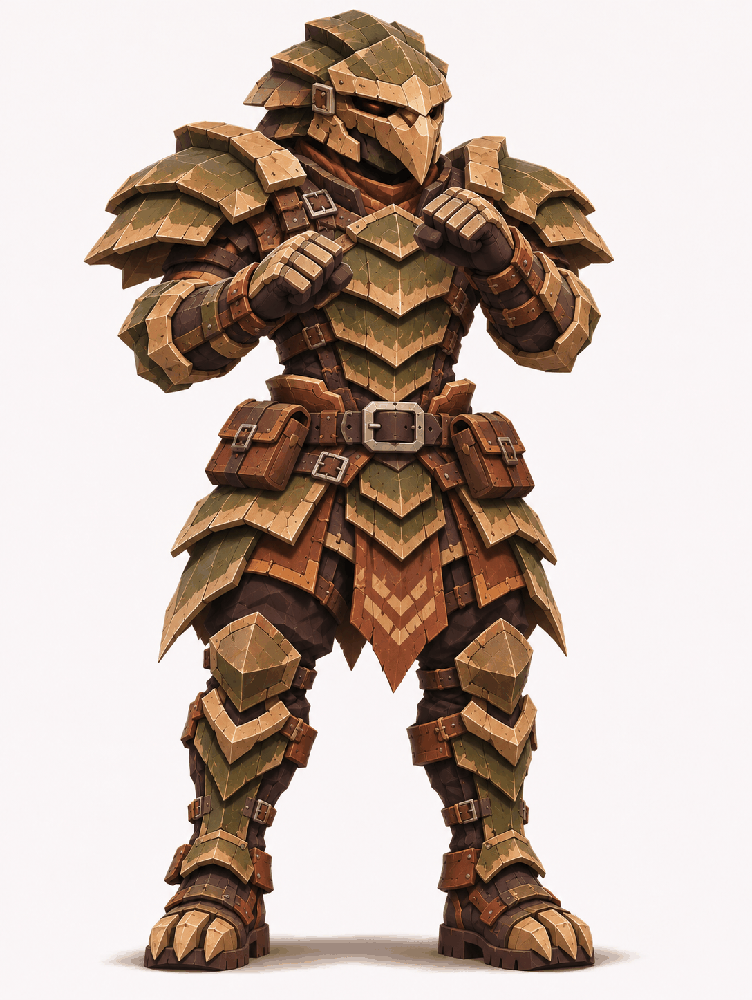

# WILDHAVEN — Set Raizauro v01 · Armadura do Escavador

**ESTADO: CONCEITO — AGUARDANDO APROVAÇÃO ARTÍSTICA DO DIRETOR.** Ilustração original de IA em PNG; **não é render de um GLB real**, armadura vestida no rig 3D nem asset integrado à Alpha.

## Identidade da espécie

- **Nome da criatura:** Raizauro, réptil **herbívoro escavador** da **savana**.
- **Referência anatômica:** Raizauro v03, GLB real de blockout ainda em revisão artística. A forma inclui tronco baixo e largo, placas dorsais facetadas **integradas ao dorso**, ombros protegidos, membros anteriores musculosos com **quatro garras escavadoras por pata**, cauda grossa segmentada, bochechas ossudas, olhos ocre embutidos e **bico córneo recurvo**.
- **Não atribuir à espécie:** chifres, presas de predador, asas, fogo, espinhos flutuantes ou qualquer traço não documentado.
- **Estilo:** equipamento original de caça Wildhaven; inspiração de design em Monster Hunter, mas **sem copiar conjuntos específicos**. Silhueta humana low-poly angular, com superfícies de placas construídas e articulações funcionais.

## Ficha detalhada da armadura

| Parte | Arte conceitual e intenção |
| --- | --- |
| **Capacete / máscara** | Elmo fechado em placas oliva e areia. A proteção do nariz e mandíbula termina em **bico córneo recurvado** que evoca o focinho original. Visor âmbar escuro embutido sob sobrancelha angular. Sem chifres adicionados. |
| **Peitoral** | Couraça frontal em camadas V de placas como os escudos dorsais, com núcleo de couro e separações visíveis entre as placas. |
| **Ombreiras** | Escudos largos escalonados com escamas facetadas, evocando os ombros blindados do Raizauro; folga na axila para elevação de braço. |
| **Manoplas** | Braçadeiras articuladas e luvas grossas; ponta dos dedos reforçada, com referências moderadas às garras escavadoras, sem transformar a mão em uma garra animal. |
| **Cinturão** | Fivela metálica, duas bolsas utilitárias, tiras e bainhas flexíveis para utensílios e equipamento de campo. |
| **Proteção das pernas** | Saiote curto de painéis articulados nas coxas; peças separadas que permitem abertura dos quadris e corrida. |
| **Grevas e botas** | Caneleiras com placas angulares, joelheiras e pontas grossas segmentadas, evocando patas de apoio e escavação sem perder a anatomia humana. |

### Materiais, cores e geometria (propostas)

**Materiais de aparência:** placas córneas inspiradas na couraça; couro curtido; tecido escuro de base; pequenas ferragens e fivelas; detalhes de garras. São **propostas narrativas**, não itens confirmados da tabela de drops/crafting.

**Paleta baseada no código de criação da espécie:**
- Corpo oliva: `#625f45`; dorso: `#75694d`; laterais: `#766c50`.
- Placas: `#8b744f`, iluminadas `#a48754`.
- Ferrugem: `#91583b`; ocre de olhos: `#c9933b`.
- Bico: `#ae9a76`; escuro das garras: `#4b4436`.

**Para a futura versão 3D:** placas grandes apenas onde afetam a silhueta; riscos, manchas e colorização por **texturas UV** em vez de malhas de cor. Reduzir sobreposições nas axilas, joelhos, punhos e no campo de visão do capacete. Verificar proporções do Hunter, ossos, matrizes de bind e escala antes de modelar detalhes.

### Gameplay — não oficial

- **Raridade proposta:** intermediária (somente hipótese de direção artística).
- **Atributos propostos:** defesa física e utilidade para atravessar solo acidentado; **sem valores numéricos, bônus, penalidades ou resistências oficiais**.
- Nenhuma receita de crafting, probabilidade de drop ou classificação de item foi definida.

## Qualidade do arquivo e relação com o Hunter

- **PNG publicado nesta pasta:** `set_raizauro_conceito_v01.png`, **1088 × 1446 pixels**, PNG de 256 cores indexadas com **dimensões integrais** e aparência preservada, não miniatura, **770.931 bytes**; SHA-256 `c84b11ce82158206c7d882697d44a1748d21cb6366e7327c9fb1b6e92d555f9e`; Git blob `0c6b1c79a4ba5c7c6436ae9586e5847678138882`. O mestre RGB original de 2.085.770 bytes está entregue no chat, sem publicação na branch. A conversão de paleta é uma otimização visual, não preservação byte a byte do mestre.
- O conceito apresenta **um único Hunter masculino, corpo inteiro**, em pose de guarda, fundo neutro e máscara fechada.
- O modelo oficial é `assets/hunters/hunter-workshop/base/hunter-masculino-1000v/hunter_masculino_1000v.glb`, com 1.000 triângulos e esqueleto de 19 ossos descritos no manifesto. **A arte não é aplicação técnica sobre essa malha ou sua textura.** O encaixe exato com o corpo/rig será avaliado apenas quando a modelagem GLB for autorizada.

## Referências de projeto realmente consultadas

1. [Regras AGENTS.md no Wildhaven](https://github.com/carioca1111/wildhaven/blob/main/AGENTS.md) e [wildhaven-new](https://github.com/carioca1111/wildhaven-new/blob/main/AGENTS.md).
2. [Oficina do Hunter](https://github.com/carioca1111/wildhaven-new/blob/main/assets/hunters/hunter-workshop/README.md), [manifesto do Hunter](https://github.com/carioca1111/wildhaven-new/blob/main/assets/hunters/hunter-workshop/base/hunter-masculino-1000v/manifest.json) e [textura original](https://github.com/carioca1111/wildhaven-new/blob/main/assets/hunters/hunter-workshop/base/hunter-masculino-1000v/hunter_textura.png).
3. [Raizauro v03 — README](https://github.com/carioca1111/wildhaven-new/blob/main/assets/models/creatures/raizauro-v03-pilot/README.md), [manifesto](https://github.com/carioca1111/wildhaven-new/blob/main/assets/models/creatures/raizauro-v03-pilot/manifest.json), [gerador de geometria/paleta](https://github.com/carioca1111/wildhaven-new/blob/main/assets/models/creatures/raizauro-v03-pilot/source/build.py) e [GLB da criatura](https://github.com/carioca1111/wildhaven-new/blob/main/assets/models/creatures/raizauro-v03-pilot/raizauro-v03-anatomy-blockout.glb).
4. [Linguagem facetada — exemplos de criaturas v03](https://github.com/carioca1111/wildhaven-new/blob/main/docs/prompts/referencias/exemplos-criaturas-v03.md) e [PR #40 no repo original](https://github.com/carioca1111/wildhaven/pull/40).

**Escopo da inspeção:** os arquivos binários da criatura e textura do Hunter foram localizados e consultados como dados GitHub, com a anatomia e paleta extraídas do README/manifesto/gerador. Não houve importação para Blender, renderização local do GLB, validação métrica ou reconstrução UV. A documentação da espécie menciona prévias v03, mas a pasta `previews/` não constava na branch principal consultada; **não** alegar que essas prévias foram verificadas visualmente.

## Histórico e aprovação

Conjuntos anteriores já identificados: [Talvero #53](https://github.com/carioca1111/wildhaven-new/pull/53), [Turvagal #54](https://github.com/carioca1111/wildhaven-new/pull/54), [Garruva #55](https://github.com/carioca1111/wildhaven-new/pull/55), [Torvardo #56](https://github.com/carioca1111/wildhaven-new/pull/56) e [Mastélio #57](https://github.com/carioca1111/wildhaven-new/pull/57). Rambrél tem conceito mostrado no chat. Nenhum conjunto Raizauro identificado nos PRs/branches consultados.

- [x] Selecionar criatura ainda sem conjunto documentado e revisar referências.
- [x] Produzir imagem individual com corpo inteiro e máscara.
- [x] Publicar **PNG original completo**, documentação e manifesto em branch nova.
- [ ] **Aprovação artística do diretor**.
- [ ] Vistas extras e separação de peças, se solicitadas.
- [ ] Autorização explícita do diretor para iniciar **blockout GLB real**.
- [ ] Renders do GLB real em frente, perfil, três-quartos para aprovação.
- [ ] Refinar malha, UVs e texturas após aprovação do blockout.
- [ ] Adicionar rig, skinning e animações após aprovação.
- [ ] Encaminhar ao Filtro de Qualidade e integrar somente em etapa distinta.

**Não modificar Alpha; não substituir assets aprovados; não fazer merge automático.**
