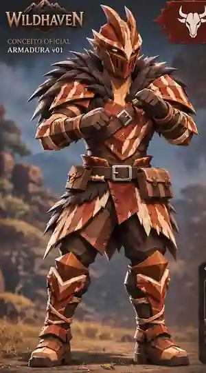

# Wildhaven — Set Talvero · capacete-máscara · conceito v01

**Status:** CONCEITO / AGUARDANDO APROVAÇÃO DO DIRETOR.  
**Tipo:** armadura completa do Hunter; apenas arte 2D. **Não é GLB nem render 3D.**  
**Bioma:** savana · **criatura-base:** Talvero (pastador/corredor de manada).  
**Inspiração visual:** armaduras de caça com silhueta marcante, linguagem inspirada em *Monster Hunter*, desenho original do Wildhaven.  
**Referências de fauna:** Talvero v04 (base relatada como aprovada); o pacote de LOD v05 segue em revisão artística. Consulte [pacote de fauna](../../../../../models/creatures/savanna-herbivores-lowpoly-v05/README.md) e [estado verificado](../../../../../../docs/prompts/referencias/estado-verificado.md).

## Arte individual

Arquivo: `set_talvero_capacete_conceito_v01.webp` — **prévia otimizada 300 × 541 px**, preservada em repositório; a imagem original em resolução maior está na entrega do chat. Sem apresentação como modelo GLB ou render técnico.

## Descrição do conjunto

| Parte | Direção de design |
| --- | --- |
| **Capacete-máscara** | Máscara integral de couro endurecido e lâminas facetadas cor de terracota; visor horizontal estreito, respiradouro frontal e crista tripartida ornamental que evoca a velocidade do Talvero. As projeções são **ornamentos de armadura**, não afirmação de chifres naturais da espécie. |
| **Ombreiras** | Placas arredondadas com faixas claras inspiradas na pelagem; grande crina escura no pescoço e parte posterior. |
| **Peitoral** | Peças de couro laminado vermelho-ocre, marcações creme e correias com fivela central. |
| **Manoplas** | Luvas articuladas e braçadeiras segmentadas, mantendo punhos e cotovelos funcionais. |
| **Cinturão / faixas** | Bolsas utilitárias laterais e saias de couro/peles sobrepostas para mobilidade. |
| **Grevas / botas** | Joelheiras prismáticas, caneleiras firmadas por tiras e botas resistentes da savana. |

### Cores e materiais propostos

- **Cores:** terracota, castanho escuro, creme, couro curtido e ferragens cinza.
- **Materiais narrativos:** couro resistente, pelagem sintética/obtida de fauna, tecidos grossos, tiras e pequenas ferragens; receita real de crafting **a definir**.
- **Assinatura do Talvero:** crina escura, manchas/faixas claras e agilidade; não reproduzir elementos anatômicos não verificados como se fossem partes reais da criatura.
- **Proteção / defesa / resistências / raridade:** **não definidas**; arte não estabelece números de gameplay.

## Controle de produção

- [x] Conceito frontal com capacete ou máscara.
- [x] Arte individual versionada (WebP de prévia).
- [x] Relação com bioma, criatura e peças documentada.
- [ ] Aprovação artística do diretor.
- [ ] Versões adicionais: costas, lateral e vistas das peças isoladas.
- [ ] Blockout **GLB real** sobre o rig e proporções do Hunter oficial.
- [ ] Renderizações **reais do GLB**: perfil, frente, três-quartos.
- [ ] Revisão de anatomia, colisões/clip, articulações e topologia.
- [ ] Refinamento UV/texturas; cores e padrões em **textura UV**, não malhas de cor.
- [ ] Rig, skinning e animações.
- [ ] Auditoria pelo Filtro de Qualidade.
- [ ] Aprovação final e integração específica no jogo.

**Restrições:** nenhuma alteração da Alpha; não substituir versões aprovadas; não mesclar automaticamente esta branch; preservar o PNG mestre na entrega do chat. O cabeçalho da arte é decorativo e não indica que foi aprovada pelo diretor.
