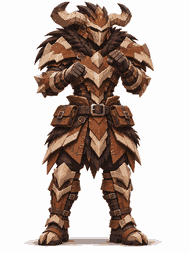

# WILDHAVEN — Set Torvardo v01 · Armadura do Colosso

**Status:** `CONCEITO / AGUARDANDO APROVAÇÃO ARTÍSTICA DO DIRETOR`. Não aprovado nem integrado ao jogo.

> **Natureza da imagem:** ilustração conceitual 2D produzida por IA, com proporções visuais próximas ao Hunter masculino do Wildhaven. **Não** é screenshot/render de GLB, skin ou montagem técnica sobre o mesh original. O PNG publicado é uma prévia de **190 × 253 pixels** com paleta otimizada. O PNG mestre de **1087 × 1446 pixels** permanece na entrega da conversa e **não foi enviado ao GitHub**.

## Identidade da espécie e do conjunto

- **Nome:** Set Torvardo — Armadura do Colosso.
- **Criatura-base:** Torvardo v03 — grande herbívoro pastador da **savana**.
- **Anatomia conferida:** corpo robusto, caixa torácica alta, **escudo córneo frontal, dois chifres curvos para fora, juba facetada em camadas e cascos bipartidos**. Estas são características reais documentadas da espécie; não adicionar espinhos de predador, presas ou anatomia reptiliana.
- **Direção visual:** equipamento original Wildhaven de caça pesada, com estética inspirada em Monster Hunter, superfícies de planos baixos, bordas duras, massas construídas e proteção articulada.
- **Hunter:** silhueta visual masculina do modelo-base oficial. A adaptação 3D às proporções exatas, rig e colisões do arquivo `hunter_masculino_1000v.glb` precisará ser testada **somente após autorização de modelagem**.

## Peças e materiais

| Peça | Descrição |
| --- | --- |
| **Capacete ou máscara** | Máscara integral fechada, viseira estreita e proteção de mandíbula; placa córnea frontal com relevo em crista; dois chifres laterais curvados para fora, como no Torvardo. Ornamentos dimensionados para não atravessar ombreiras. |
| **Peitoral** | Placa central córnea em V, segmentos castanhos espessos e costuras de couro; tronco visualmente robusto sem impedir rotação do braço. |
| **Ombreiras** | Duas proteções largas escalonadas; bordas creme e densa gola de crina geométrica, remetendo à juba natural. |
| **Manoplas** | Luvas fechadas com punhos robustos e braçadeiras de couro, fivelas e placas de proteção dos antebraços. |
| **Cinturão** | Fivela central, dois bolsos utilitários e painéis sobrepostos na cintura. |
| **Proteção das pernas** | Saiote escalonado com espaços para flexão do quadril, coxas protegidas sem excesso de volumes adicionais. |
| **Grevas e botas** | Joelheiras prismáticas, caneleiras de placas sobre tiras de couro e botas de frente bipartida evocando o formato dos cascos. |

**Materiais inspirados na criatura (não são receita de drop):** couro castanho curtido, crina escura, placas córneas claras, motivos de chifres, cordas, tecidos de apoio e pequenas ferragens.

**Paleta sugerida do Torvardo (valores da fonte do gerador):**
- Pelo/couro castanho: `#73452d`, luz `#8e5937`, dorso `#965e39`;
- Juba escura: `#38251f`, médias `#4e3228`;
- Placas/chifres: `#b6a080`, `#a49a7e`, pontas `#413d34`;
- Forro e couro de sombra: `#30231e`.

**Raridade:** *proposta*, intermediária/alta, ainda sem aprovação. **Atributos:** *proposta* de defesa alta e mobilidade ponderada; **sem números oficiais, efeitos, receitas ou buffs definidos**. Evitar interpretar porte de herbívoro como estatística confirmada de armadura.

## Fontes verificadas

- [AGENTS.md — regras do repositório Wildhaven](https://github.com/carioca1111/wildhaven/blob/main/AGENTS.md)
- [AGENTS.md — repositório de trabalho](https://github.com/carioca1111/wildhaven-new/blob/main/AGENTS.md)
- [Oficina do Hunter](https://github.com/carioca1111/wildhaven-new/blob/main/assets/hunters/hunter-workshop/README.md)
- [Torvardo v03 — README do piloto](https://github.com/carioca1111/wildhaven/blob/6775583101b375112cfd9504d3d7a7a3d459bca4/assets/models/creatures/torvardo-v03-pilot/README.md)
- [Torvardo v03 — manifesto técnico](https://github.com/carioca1111/wildhaven/blob/6775583101b375112cfd9504d3d7a7a3d459bca4/assets/models/creatures/torvardo-v03-pilot/manifest.json)
- [Torvardo v03 — fonte de construção e paleta](https://github.com/carioca1111/wildhaven/blob/6775583101b375112cfd9504d3d7a7a3d459bca4/assets/models/creatures/torvardo-v03-pilot/source/build.py)
- [GLB anatômico real Torvardo v03 (apenas referência)](https://github.com/carioca1111/wildhaven/blob/6775583101b375112cfd9504d3d7a7a3d459bca4/assets/models/creatures/torvardo-v03-pilot/torvardo-v03-anatomy-blockout.glb)
- [Exemplos de criaturas facetadas e PR 39](https://github.com/carioca1111/wildhaven-new/blob/main/docs/prompts/referencias/exemplos-criaturas-v03.md)

O README do Torvardo v03 e seu manifesto registram **blockout real em revisão artística**, sem rig/anim e sem aprovação final. O usuário escolheu o piloto como *referência visual*. Referenciar o piloto não equivale à aprovação final do GLB da espécie ou deste conjunto de armadura.

## Status e etapas de produção

- [x] Anatomia, cores, GLB de referência e histórico de PRs inspecionados por metadados, README e código.
- [x] Conferidos conjuntos anteriores (Talvero, Turvagal e Garruva nos PRs; Rambrél em conceito apresentado no chat).
- [x] Conceito **individual** do Hunter de corpo inteiro com máscara fechada, sem prancha.
- [x] PNG de prévia, documentação e manifesto publicados em branch isolada.
- [ ] **Aprovação explícita** da arte pelo diretor.
- [ ] Opcional: anexar o PNG mestre em alta resolução ao GitHub.
- [ ] Vistas lateral/costas e estudo de peças.
- [ ] **GLB real** de blockout sobre Hunter oficial; renders reais de frente, perfil e ¾.
- [ ] Aprovação do blockout antes de refinamento.
- [ ] UVs/texturas, sem geometria extra só para padrões pintados.
- [ ] Rig, skinning e animações depois de aprovação.
- [ ] Filtro de Qualidade e eventual integração independente.

**Não alterar Alpha, não sobrescrever outras armaduras ou modelos, não fazer merge automático.**
