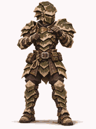

# Wildhaven — Set Turvagal v01

**Estado:** CONCEITO 2D — AGUARDANDO APROVAÇÃO DO DIRETOR. Não é modelo ou render GLB. Não integrado à Alpha.

**PNG no GitHub:** prévia compacta de 165 × 220 pixels (8.433 bytes). **PNG mestre:** arte gerada nesta conversa, 1087 × 1446 pixels, entregue separadamente. A imagem do GitHub não é a resolução mestre.

## Espécie e direção

- **Criatura-base:** Turvagal, herbívoro das margens da savana.
- **Referências da espécie:** corpo pesado, placas dorsais, pescoço baixo, paleta oliva/verde-escuro e creme.
- **Estética:** armadura original do Wildhaven com linguagem de equipamentos de caça inspirada em Monster Hunter, formas low-poly facetadas sobre as proporções do Hunter masculino.
- **Anatomia:** sem chifres, garras ou presas inventados. Placas do equipamento se inspiram nas placas dorsais confirmadas.

## Ficha de armadura

| Peça | Proposta visual |
|---|---|
| Capacete / máscara | Elmo fechado com visor estreito, mandíbula protegida e placas largas sobrepostas, sem chifres |
| Peitoral | Placas escamadas largas em camadas, com couro articulado sob a proteção |
| Ombreiras | Proteção volumosa e segmentada inspirada no dorso do Turvagal |
| Manoplas | Couro, reforços no punho e braçadeiras facetadas |
| Cinturão | Fivela, bolsas e cordas de caça |
| Coxas | Painéis separados com espaço para flexionar quadris e joelhos |
| Grevas e botas | Caneleiras segmentadas e calçados reforçados para terreno úmido |

**Materiais conceituais:** placas de aparência orgânica, couro, tecido, correias, ferragens e corda. Não são ingredientes oficiais de crafting.

**Paleta:** verde-oliva, musgo, creme-areia, couro marrom, metal fosco. Futuras manchas e pinturas deverão usar texturas UV, nunca polígonos destinados somente à coloração.

**Raridade:** não definida; comum/incomum pode ser avaliado. **Atributos:** proteção e estabilidade em solo úmido como ideias, sem qualquer estatística oficial.

## Fontes conferidas

- [AGENTS.md](https://github.com/carioca1111/wildhaven-new/blob/main/AGENTS.md)
- [Oficina do Hunter](https://github.com/carioca1111/wildhaven-new/blob/main/assets/hunters/hunter-workshop/README.md)
- [Fauna da savana: estado e formas](https://github.com/carioca1111/wildhaven-new/blob/main/assets/models/creatures/savanna-herbivores-lowpoly-v05/README.md)
- [Gerador anatômico e paleta](https://github.com/carioca1111/wildhaven-new/blob/main/assets/models/creatures/savanna-herbivores-lowpoly-v05/source/base_v02.py)
- [GLB de referência Turvagal v03](https://github.com/carioca1111/wildhaven-new/blob/main/assets/models/creatures/turvagal/turvagal-savanna-animated-v03-LOD0.glb)

**Verificação:** consultados documentação, árvore e código, sem afirmar importação ou renderização do GLB real da espécie. Modelo experimental ainda pode requerer aprovação artística.

## Etapas e travas

- [x] Arte individual com capacete, corpo inteiro e fundo neutro
- [x] PNG de prévia, documentação e manifesto em branch separada
- [ ] Aprovação artística do diretor
- [ ] Vistas extras e separação de peças
- [ ] Blockout **GLB real** e três renders **reais** após autorização
- [ ] Aprovação de forma, refinamento geométrico, UVs e texturas
- [ ] Rig, skinning, animações e Filtro de Qualidade
- [ ] Aprovação final do diretor e integração independente

Não alterar Alpha, não substituir outros conjuntos, não fazer merge automático.
