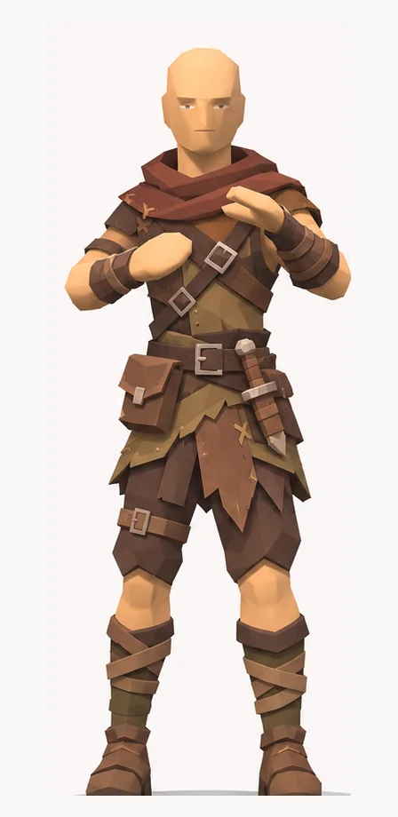
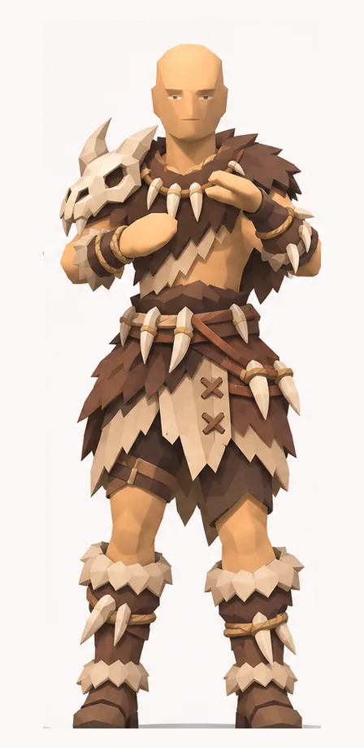
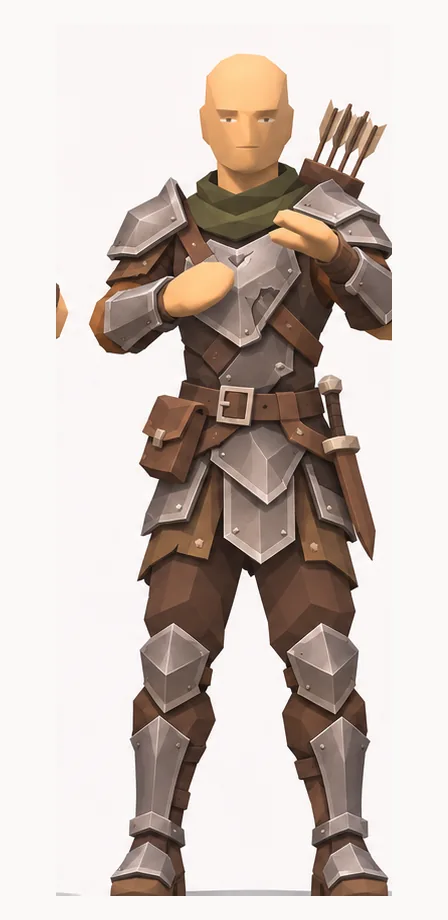
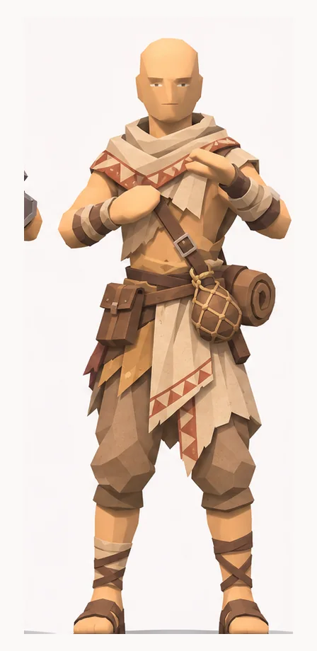

# Wildhaven — Conceitos individuais de armaduras do Hunter (v01)

**Status artístico:** CONCEITO — aguardando aprovação do diretor, conjunto por conjunto.
**Status técnico:** apenas imagens estáticas (WebP, 448 × 920 px), não são modelos GLB, UVs nem renders de GLB.
**Alpha:** não integrada; nenhum asset aprovado alterado.

## Conceitos

### 01 — Couro do Explorador

Armadura leve de couro, tecido, tiras, braceletes e bolsas de campo.

### 02 — Ossos e Peles

Caçador tribal robusto, com crânio, dentes, peles e cordões.

### 03 — Metal do Caçador

Conjunto segmentado de metal, couro, ombreiras e perneiras.

### 04 — Sobrevivente do Deserto

Tecido respirável, lenço, faixas de proteção, recipientes e bolsas.

## Origem e restrições

- Referência: PNG frontal do Hunter fornecido pelo diretor em 2026-11-16.
- As quatro artes são **recortes individuais da mesma prancha conceitual gerada**, não renders de modelos 3D.
- Mantidos em arquivos separados para revisão e aprovação individual.
- Os arquivos WebP aqui são versões visualmente fiéis e otimizadas para repositório; os PNGs individuais sem essa compressão foram disponibilizados no chat original.
- Não iniciar modelagem, rigging ou integração automática com base nestas artes sem aprovação explícita.
- Para modelagem de equipamentos, criar depois vistas de costas/lateral, detalhamento de encaixes e orçamento de triângulos, respeitando o rig e a escala do Hunter atual.
- Não alterar a Alpha nem sobrescrever modelos aprovados.

## Integridade dos arquivos

| Arte | Bytes WebP | SHA-256 |
|---|---:|---|
| `01_couro_explorador.webp` | 23296 | `88312788c0ebe0bb9971ca5cde7aa3d2121ba606c80a346e2ebde1dea36c9d31` |
| `02_ossos_e_peles.webp` | 30214 | `a66b76b24c513d8e40279db7e5ab9ca638d4f1e1993b3eb5904142f216e85073` |
| `03_metal_cacador.webp` | 27490 | `3aee6e9c74449de76344952ca1cac2971093b24185ccf603eef15c0fa15ad261` |
| `04_sobrevivente_deserto.webp` | 26908 | `4fe2e98a504b629b156439bf2c53da7ac5dc02ce40a69a00e2dffa0ac3035847` |

Data da preparação: 2026-11-16.
