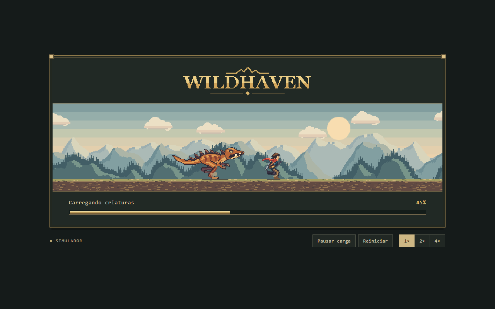

# Wildhaven · Carregamento 16-bit V02

Demonstração independente do painel de carregamento da Build Real. A página usa HTML, CSS e Canvas 2D com PNGs locais. O diretório de revisão contém a filmagem e o teste automatizado. Apenas os assets da interface são carregados pela página.

[Gravação de 21 ciclos no navegador](review/corrida.webm) · [Doze poses lado a lado](review/quadros.png) · [Medições](review/medidas.json)

## Abrir

Na pasta desta versão, execute o comando abaixo e abra [o simulador local](http://127.0.0.1:8827/).

~~~sh
python -m http.server 8827 --bind 127.0.0.1
~~~

Pausar carga mantém a corrida ativa. Reiniciar retorna a 0%. Os controles 1×, 2× e 4× alteram a velocidade da carga simulada. O percurso contém esperas entre tarefas. Quando a aba fica oculta, o agendamento de desenho é suspenso. A preferência de movimento reduzido congela o ciclo corporal.

## Personagens e cenário

A composição segue o documento [09 da Build Real](../../09-tela-carregamento.md). Ele registra uma demonstração conceitual anterior. Na árvore consultada do PR #106, o material de carregamento disponível era esse documento. A folha do Hunter e o letreiro desta versão são novas interpretações em pixel art.

O Hunter corre para a direita em doze poses. A perna distante conserva a paleta escura mesmo ao passar à frente. Os braços contrabalançam as pernas. A espada acompanha o tronco e a ponta do cachecol muda de altura ao longo do ciclo. A base de personagem e sua textura estão em [Hunter Workshop](../../../assets/hunters/hunter-workshop/base/hunter-masculino-1000v/).

O Varrisco é um sprite cartum desenhado em doze poses. O perfil bípede, a cauda longa, os braços curtos e os espinhos dorsais vêm do [Varrisco de referência](../../../assets/models/creatures/varrisco/v02/). A corrida alterna a perna distante escura e a próxima iluminada. As mãos acompanham a passada e os impactos dos pés nos quadros 0 e 6 disparam a poeira. [Fonte do desenho e do movimento](review/draw_varrisco.py)

Três faixas montanhosas se deslocam a 12%, 27% e 52% da velocidade relativa do chão. As nuvens têm duas velocidades. A poeira usa seis quadros e um pool fixo de 32 partículas. A escala e a duração da poeira variam conforme o personagem.

## Conectar um carregador

A primeira chamada a setProgress assume o controle da barra. O chamador fornece uma fração medida entre 0 e 1. Para uma etapa sem percentual conhecido, null mantém o valor anterior. A transição para o mundo jogável cabe ao jogo quando seus recursos estiverem prontos.

~~~js
WildhavenLoading.setProgress(completedBytes / totalBytes, 'Carregando terreno');
WildhavenLoading.setProgress(null, 'Preparando o mundo');
WildhavenLoading.setProgress(1, 'Mundo pronto');
~~~

## Validação

O Edge 158 executou 21 ciclos completos em 15,29 s, a 59,90 FPS médios. O percentil 95 do intervalo entre chamadas de animação foi de 16,8 ms. A captura WebM a 30 FPS estava ligada. O computador Windows de teste dispõe de vídeo integrado Intel Iris Xe. O teste mediu a cadência do navegador em modo headless, sem instrumentação de tempo de GPU.

A validação registrou 86 impactos e no máximo três partículas ativas simultaneamente. Houve 43 mudanças de quadro durante trechos de percentual estacionário. As mãos do Hunter percorreram 18 pixels cada no eixo horizontal. No Varrisco, os pés tiveram amplitude de 20 pixels cada, os braços de 8 pixels e a ponta da cauda de 8 pixels. A prancha permite conferir a transição do último quadro para o primeiro.

Foram exercitados pausa, retomada por reinicialização, velocidades, conclusão a 100%, progresso externo, etapa indeterminada e largura de 375 px. Para repetir o teste com o servidor ativo, execute `node review/test.cjs` com Playwright resolvível pelo Node ou indique o pacote em PLAYWRIGHT_PATH. O teste usa o canal msedge e regenera a filmagem, as imagens e as medições.

## Três cenas de carregamento

A página principal sorteia uma cena ao abrir e ao reiniciar. Os endereços abaixo fixam a cena para revisão. Pausar a carga preserva a perseguição em andamento.

- [Montanhas](http://127.0.0.1:8827/?cena=hunter) — Hunter e Varrisco.
- [Dunas](http://127.0.0.1:8827/?cena=dunas) — o Arenoceto emerge atrás do barco a vela. A embarcação é uma interpretação provisória. A referência de montaria localizada pelo nome foi o Dodarro. [Captura](review/dunas.png)
- [Savana](http://127.0.0.1:8827/?cena=savana) — o [Gravarto](https://github.com/carioca1111/wildhaven/pull/51), grande réptil carnívoro da savana inspirado em Megalania, persegue o Velsari, herbívoro de pelagem dourada, orelhas grandes e chifres curtos. [Captura](review/savana.png)

O teste `node review/test-scenes.cjs` exercita o sorteio em 100 reinícios e acompanha 20 ciclos de cada nova perseguição no navegador. As duas usam sprites de 12 poses e três faixas de paisagem. [Fonte da arte](review/draw_chases.py)
