# Laboratório de IA das criaturas

## Oficina de criaturas — catálogo dinâmico (experimental)

A página `ecossistema.html` agora contém o painel recolhível **Oficina · catálogo de criaturas**. 
Com `npm run dev`, o servidor oferece `GET /__catalogo`, que encontra **todos os arquivos GLB** sob
`assets/models/creatures/` no clone local e associa fichas de `creatures/species/` quando existem.
Nenhum caminho fica preso à lista de cinco espécies de `config/eco/indice.json`.

**Uso:** abra a demo, expanda Oficina, busque um nome ou arquivo, selecione o GLB, defina o papel
terrestre (herbívoro/carnívoro), nome, quantidade, frente anatômica, massa, dimensões, velocidade,
fome, sede, vida e visão. Predadores podem escolher uma presa; herbívoros podem ser adicionados como
presas dos predadores já presentes. Clique **Adicionar / salvar** e depois **Aplicar e reiniciar**.
Repita para combinar vários animais. As escolhas ficam somente no navegador (localStorage);
a simulação é recriada com uma sobreposição **em memória** do cenário e das fichas.

- O GLB é lido **do caminho original**. A escala é estimada com as dimensões da própria malha;
  clipes são selecionados entre os que existem. Quando um modelo não tem rig/animação adequada,
  ele ainda pode ser exibido, mas isso não valida sua locomoção.
- Fichas de animais desconhecidos são adaptadas de duas bases existentes (Velsari/Varrisco),
  com valores **provisórios**. Os arquivos do catálogo e as regras oficiais nunca são regravados.
- A **IA terrestre** atual permite encontros, caça, fuga, socialização e necessidades.
  **Não** implementa ainda navegação 3D subterrânea, voo, natação na areia, escavação de ninhos
  ou consumo persistente de cupins. Tocar os clipes `swim_sand`/`burrow` não cria essa física.
- O catálogo dinâmico depende do **servidor local**. `dist-eco/` continua hospedando os cenários
  originais; não inclui automaticamente os possivelmente centenas de GLBs descobertos.
- A aprovação artística dos quatro animais das dunas foi confirmada pelo responsável;
  esta oficina não faz integração automática à Alpha. A validação em jogo continua separada.

**Arquivos:** `scripts/catalogo-criaturas.mjs` (descoberta), `src/eco/oficina.js`
(fichas e encontros), `src/web3d/oficina-ui.js` (painel), `test/eco-oficina.test.mjs` (testes).
Teste local: `node --test test/eco-oficina.test.mjs` seguido de `npm test`.

## Oficina V2 — habilidades, perfis físicos, diagnóstico e presets

A Oficina de Criaturas abre em `ecossistema.html` → **Oficina · catálogo de criaturas**,
no servidor local `npm run dev`. Descobre arquivos GLB de `assets/models/creatures/`,
incluindo versões que não constam nas cinco espécies do índice da IA. Os arquivos `manifest.json`
são lidos quando o caminho do GLB coincide com o manifest, permitindo sugerir o meio de locomoção
pelo clipe realmente declarado (por exemplo, `swim_sand` → `subterraneo_areia`).
Isso não significa que já existam navegação, colisão e percepção tridimensionais no motor.

**Capacidades declarativas:** `escavar`, `nadar_areia`, `voar`, `detectar_vibracoes`,
`nadar_agua`. Os perfis `terrestre`, `subterraneo_areia`, `voador` e `aquatico` são
diferentes. **Areia nunca é tratada como água.** Apenas o perfil terrestre utiliza o
controlador atual. Para os demais a Oficina bloqueia a simulação até haver controlador
específico; a opção explícita **proxy de superfície** permite testar somente necessidades,
encontros e exibição do GLB, mantendo o estado `proxy_superficie` visível nas fichas.
Um proxy **não** valida voo, deslocamento subterrâneo, mergulho ou alimentação por cupins.

**Diagnóstico de GLB real:** selecione modelo, clique **Diagnosticar GLB real**. O laboratório
carrega o arquivo original e confere clipes, mapa de animações, durações, skin e número de
ossos. O resultado é estrutural: não substitui vídeo real ou medição de IK/colisões.

**Presets:** informe nome e clique Salvar. Cada preset guarda nome, cenário (e terreno
referenciado pelo cenário), semente, seleção e parâmetros das espécies. É possível carregar,
excluir, exportar ou importar JSON. Os arquivos são validados contra IDs/caminhos atuais
do catálogo; dados antigos ou modelos removidos são recusados. Nenhum preset é mesclado ao mapa
oficial, ao conteúdo da Alpha ou às fichas oficiais.

**Verificação:**
- `npm test`: testes do ecossistema e da Oficina, incluindo checagem binária real dos GLBs
  Arenoceto/Arraia e regressões de travessia; a CI repete esses testes.
- `npm run build` e `npm run demo-hospedada`: verificações da versão atualizada.
- `node scripts/testar-oficina-navegador.mjs` (com Playwright + Chromium disponíveis):
  navegador real abre Oficina, encontra Arenoceto, audita seu GLB, habilita proxy
  explicitamente, salva preset e inicia simulação com dois indivíduos. A CI inclui esse smoke.
- `https://github.com/carioca1111/wildhaven-new/pull/1` contém a branch experimental;
  `main` e `game/alpha01` permanecem intocadas.

**Próxima implementação (Claude):** controlador volumétrico verdadeiro de areia com
profundidade, colisões, transições superfície↔subsolo, detecção por vibrações e
interações específicas do Arenoceto e da Arraia-de-Areia; a aprovação artística dos
quatro animais das dunas não significa que esses sistemas físicos estejam prontos.

## V3 — combate, socialização e testes com GLBs reais (resumo)

Decisões, inspeção do rig e pendências: [CHECKPOINT-V3.md](CHECKPOINT-V3.md). Números: [resultados/v3/RELATORIO-V3.md](resultados/v3/RELATORIO-V3.md).

| O quê | Comando / endereço |
|---|---|
| Bancada do Varrisco (GLB original: clipes, 8 direções, giros, corrida, rochas, bote/mordida/garra, dano, caça, disputa) | `npm run dev` → http://localhost:5180/laboratorio-varrisco.html |
| Savana Viva (recorte real, 24 animais) | http://localhost:5180/ecossistema.html?cenario=savana-viva&semente=3 |
| Disputa pela presa com fuga | http://localhost:5180/ecossistema.html?cenario=disputa-presa-cobertura&semente=27 |
| Inspecionar o rig de um GLB (ossos, contato dos pés, alcance de cabeça) | `npm run inspecionar-rig -- ../../assets/models/creatures/varrisco/v02/varrisco-animated-v02-LOD0.glb` |
| Colisões antes × depois / combate / fugas / socialização / relatório | `npm run v3:locomocao` · `npm run v3:combate` · `npm run v3:fugas` · `npm run v3:social` · `npm run v3:relatorio` |
| Versão hospedada (`dist-eco/`, inclui a bancada) | `npm run demo-hospedada` |

- Locomoção: A* com margem corporal, DDA sem atalho pela quina, antecipação/desvio, separação e cápsulas anatômicas (corpos não se atravessam), frenagem em curvas, giro no lugar com `turn_left/right`.
- Patas: IK de duas articulações nos ossos reais com travamento do pé na fase de apoio medida na própria animação; ajuste ao relevo; mira de cabeça/pescoço em mordida, bote e agarrão.
- Combate: alcance, instante de impacto e osso de cada golpe medidos no GLB; acerto só quando o membro alcança o corpo; proteção natural, dor, atordoamento, músculo, empurrão/queda, agarrão; previsão de esquiva e cautela após erros.
- Disputas e fugas: a presa percebe a distração (postura e foco visíveis) e decide se acelera, busca cobertura ou se esconde; métricas de oportunidade, tentativa, fuga efetiva e recaptura.
- Social: memória individual persistente (família, parceiros, companheiros, rivais), cumprimento, limpeza mútua, brincadeira de filhotes, dominância/submissão sem dano, vigilância compartilhada, alarme de outras espécies, tolerância a predador saciado.

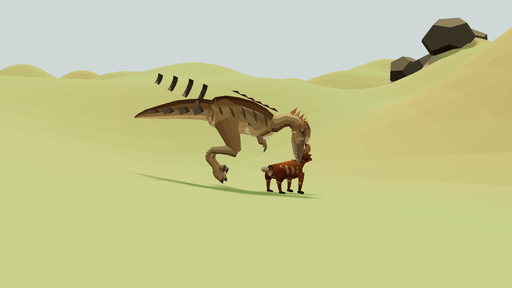

*Bancada do Varrisco: bote no instante do impacto (clipe `pounce` + salto do núcleo; cabeça mirando o pescoço do Velsari pelos ossos `neck`/`head`).*

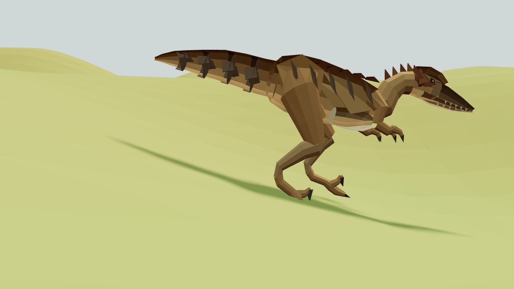

*Vista lateral: o pé de apoio fica plantado no declive (IK nos ossos `thigh → shin → foot`).*

## V7 — veneno, camuflagem, termorrecepção, voo, clima, cupins e decomposição

Relatório completo com todos os números: [`resultados/v7/RELATORIO-V7.md`](resultados/v7/RELATORIO-V7.md).

Sete sistemas novos, todos **declarativos na ficha** — quem não declara a capacidade não ganha estado
nenhum (há um teste para cada caso):

| Módulo | Capacidade na ficha | O que faz |
|---|---|---|
| `src/eco/veneno.js` | `veneno`, `resistenciaVeneno` | carga por kg com latência e meia-vida; neuro/hemo/citotóxico; só inocula depois de ferir; reserva finita |
| `src/eco/camuflagem.js` | `camuflagemAtiva` | reduz **só** a visão; custa energia; quebra ao atacar |
| `src/eco/termo.js` | `percepcao.termorrecepcao` | contraste térmico com o ar, cone, bloqueio por relevo; **nunca** identifica a espécie |
| `src/eco/voo.js` + `cerebro-voo.js` | `voo`, `voo.bando` | altitude real, estol, planeio, decolagem, pouso, desvio de relevo, asa ferida; bando por regras locais |
| `src/eco/clima.js` | `resistenciaClimatica` | chuva, tempestade de areia e nevasca num estado único lido por sentidos, locomoção, voo e fisiologia |
| `src/eco/cupins.js` | `dieta.cupins` | colônia finita, crescimento logístico, casca que só alguns abrem |
| `src/eco/carcaca.js` | `cenario.decomposicao` | estágios, insetos necrófagos, ossos e reciclagem com balanço de carne fechado |
| `src/eco/cerebro.js` | `taticasDeEmboscada`, `memoriaDePerigo` | espera na cobertura perto de presa percebida; presa evita onde foi atacada |

Alguns números medidos (detalhes e método no relatório):

* **Camuflagem** — predador parado é reconhecido a 30 m sem ela e a **4 m** com ela; correndo, a 28 m.
* **Termorrecepção** — alcance **29 m** a 8 °C de ar, **17 m** a 26 °C, **0 m** a 36,5 °C. Rocha bloqueia.
* **Voo** — 263 m voados, morro de 30 m contornado com folga mínima de 3 m, pouso a 2,2 m do alvo.
* **Bando** — 20 voadores, zero contatos de corpo, 0,736 ms/passo.
* **Chuva × controle (30 sementes)** — caçadas 52 → 20, ferimentos 13 → 1, mortes 3 → 0.
* **Carcaça** — até os ossos em 48 s a 34 °C e 720 s a 4 °C; a carne nunca é criada.

Cenários novos (`v7-a` … `v7-h`), todos experimentais e em terreno procedural do laboratório:
caçador camuflado, mordedura venenosa, bandos no céu, tempestade de areia, chuva e caça (com
controle de mesma semente), cupinzeiro, ciclo da carcaça, emboscada e ferimentos.

Scripts: `node scripts/v7-medir.mjs` (eventos, mortes e CPU por semente) e
`node scripts/v7-taticas.mjs` (compara predadores com a capacidade ligada/desligada numa cópia da ficha).

**Protótipos declarados, não assets aprovados:** ossos procedurais, cone de cupinzeiro e as duas
espécies hipotéticas que usam o GLB de outra criatura. O inspetor mostra isso em cada ficha.

## V6 — validação física do Arenoceto, mira do combate e desempenho

Relatório completo: [resultados/dunas/RELATORIO-V6.md](resultados/dunas/RELATORIO-V6.md).

- **PR #11 validado na geometria renderizada**: a 50% do mergulho, 80,7% dos vértices do GLB real estão
  abaixo da superfície (exigido 50%); 100% ao fim. Medição em `ecoDemo.imersao(id)`, que usa os vértices
  já deformados pelo esqueleto. Aproximação declarada: fração de vértices, não de volume.
- **O corpo não atravessa mais o leito rochoso.** Antes: até 4,86 m abaixo dele, em 0,03% a 1,41% dos
  passos. Depois: zero em 18 execuções. O animal ajusta a profundidade parado e só entra quando cabe.
- **Emergência autônoma do Arenoceto**, pendente na V5. O destino de exploração deixou de ser filtrado
  pela espessura de areia a 100 m, que o animal não tem como saber; quando o leito aflora no caminho,
  a rota fica incompleta e ele emerge.
- **Dano através da areia conferido por HP** e lista de ferimentos, nos dois sentidos, com controle
  positivo no mesmo meio (`test/dunas-combate.test.mjs`).
- **Mira do combate**: 81% dos golpes erravam por `membro_nao_alcanca`. A projeção do alvo usava
  velocidade constante e a presa em fuga acelera durante o preparo. Em 30 sementes no bebedouro,
  acertos 12 → 20 e predações 6 → 10.
- **Desempenho**: pior passo 62,7 → 14,6 ms (o volume de areia passou a ser derivado na criação do mundo).
  p50 de 0,004 a 0,084 ms nos cenários de dunas.

115 testes passam, build ok. Capturas em `resultados/capturas/v6-*.png`, com câmera fixa nas cinco
etapas do mergulho.

## V5 — IA das dunas e simulação subterrânea real

Quatro espécies das dunas, um volume de areia navegável derivado do relevo real e um meio físico
próprio sob a superfície. **Areia não é água**: não há empuxo nem `nadar`; o corpo precisa de espessura
sobre o leito rochoso, a resistência cresce perto do leito e atravessar a superfície custa tempo e energia.

Números, hashes dos GLBs, sementes e limitações: [resultados/dunas/RELATORIO-DUNAS.md](resultados/dunas/RELATORIO-DUNAS.md).

### Como abrir

```bash
npm run dev
```

| Cenário | Endereço |
|---|---|
| A — natação subterrânea do Arenoceto | http://localhost:5180/ecossistema.html?cenario=dunas-a-natacao&semente=1 |
| B — Arraia-de-Areia rente à superfície | http://localhost:5180/ecossistema.html?cenario=dunas-b-arraia&semente=1 |
| C — vibrações (Escarvão enterrado, Velsaris por cima) | http://localhost:5180/ecossistema.html?cenario=dunas-c-vibracoes&semente=1 |
| D — emboscada do Serracórion | http://localhost:5180/ecossistema.html?cenario=dunas-d-emboscada&semente=3 |
| E — ecossistema das dunas (as quatro espécies) | http://localhost:5180/ecossistema.html?cenario=dunas-e-ecossistema&semente=1 |
| F — travessia subterrânea DN_22 → DN_23 | http://localhost:5180/ecossistema.html?cenario=dunas-f-travessia&semente=1 |

Marque **Inspeção subterrânea** no painel para ver o corpo enterrado através do terreno (transparência
diagnóstica), a linha de profundidade, a rota planejada no volume de areia e as linhas até os estímulos.
A representação de depuração não altera a grade física: colisões, profundidade e bloqueios continuam iguais.

### As quatro espécies e o que os GLBs sustentam

| Espécie | GLB | Capacidade real no subsolo | Limite do GLB |
|---|---|---|---|
| Arenoceto | `arenoceto/v02/arenoceto-v02-skinned-animated-LOD0.glb` (16 ossos, 20 clipes) | Nada na areia até 28 m; cruzeiro 3,2 m/s, arranque 7,5 m/s, giro 11 °/s | **Sem `walk`/`run`**: é nadador de areia obrigatório, na superfície só `idle`/`breach` |
| Arraia-de-Areia | `arraia-de-areia/v03/arraia-de-areia-v03-rig-animated-LOD0.glb` (23 ossos, 22 clipes) | Nada na areia até 9 m; cruzeiro 4,5 m/s, arranque 10 m/s, giro 85 °/s, `glide_shallow` rente à superfície | Também sem clipes de locomoção de superfície |
| Escarvão | `escarvao/v02/escarvao_cobre_rig_anim_v02.glb` (51 ossos, 18 clipes) | **Escava**, não nada: enterra-se até 1,4 m e espera; avanço 0,35 m/s | Sem clipe de deslocamento subterrâneo contínuo — `burrow` em ciclo é fallback PROVISÓRIO |
| Serracórion | `serracorion/v03/serracorion-v03-rig-animado-LOD0.glb` (43 ossos, 20 clipes) | **Escava** até 3,2 m, emboscada; avanço 0,5 m/s | `walk`/`run` com root motion quase nulo (0,008 e 0,059 m/s): a velocidade vem do motor |

As quatro foram identificadas pelo catálogo (`catalogo/entregas.json`, PRs 63, 67, 73 e 76) e pelos clipes
reais de cada GLB. **Nenhuma delas tem ficha em `creatures/species/`**: todos os números de massa, velocidade,
percepção, combate e vida são PROVISÓRIOS e estão marcados em `balanceamento.provisorios`.

### Volume de areia (`src/eco/areia.js`)

O substrato é classificado pela **cor de vértice do próprio GLB oficial** (`COLOR_0`): ocre quente com
R > G > B é areia; rocha exposta e leito escuro ficam fora. O corpo de areia é a **abertura morfológica**
do relevo com raio de 150 m (meio comprimento de onda da duna): a diferença entre o relevo e esse envelope
é a espessura de areia sobre o leito. No hexágono DN_19 isso dá 97,5% da janela navegável, 82% com 6 m ou
mais e 58% com 20 m ou mais, até o teto de 45 m. Os corredores entre as dunas ficam com leito aflorado —
são barreiras físicas de verdade, não cenário.

Nenhum GLB oficial foi modificado: o mapa é derivado em leitura e gravado no terreno derivado do cenário.

### Física subterrânea (`src/eco/subsolo.js`)

Profundidade do centro do corpo, velocidade vertical, inércia, raio de giro e resistência do material, todos
por espécie. O corpo só passa onde cabe entre a crosta e o leito (`faixaProfundidade`), e a rota é um A* no
**perfil de areia** da própria espécie — por isso um Arenoceto de 5,1 m de altura não entra onde a Arraia de
1,3 m passa. Mergulho e emergência são rampas lineares de posição e profundidade: não há teletransporte.

### Vibrações (`src/eco/vibracoes.js`)

Passos, corrida, combate, escavação, mergulho e emergência sacodem o substrato. A intensidade que chega
cai com o quadrado da distância, é atenuada pela diferença de profundidade e pela rocha no caminho, e
depende da sensibilidade da espécie. O que a criatura recebe é **um ponto com erro**, não um alvo: a
espécie da fonte só aparece quando outro sentido confirma o mesmo indivíduo. A memória de pistas decai
em 60 s. **Sob a areia não há visão, audição nem olfato** — enterrado, só resta a vibração.

### Combate entre superfície e subsolo

`separadosNaVertical` corta o golpe quando há areia sólida entre os corpos: não existe mordida através do
volume. A emboscada fecha quando os dois corpos ficam no mesmo meio — o predador emerge junto da presa ou
a alcança sob a areia, com a localização dada pela vibração a curta distância.

### Evidências visuais (renderizador real, GLBs originais)

| | |
|---|---|
| 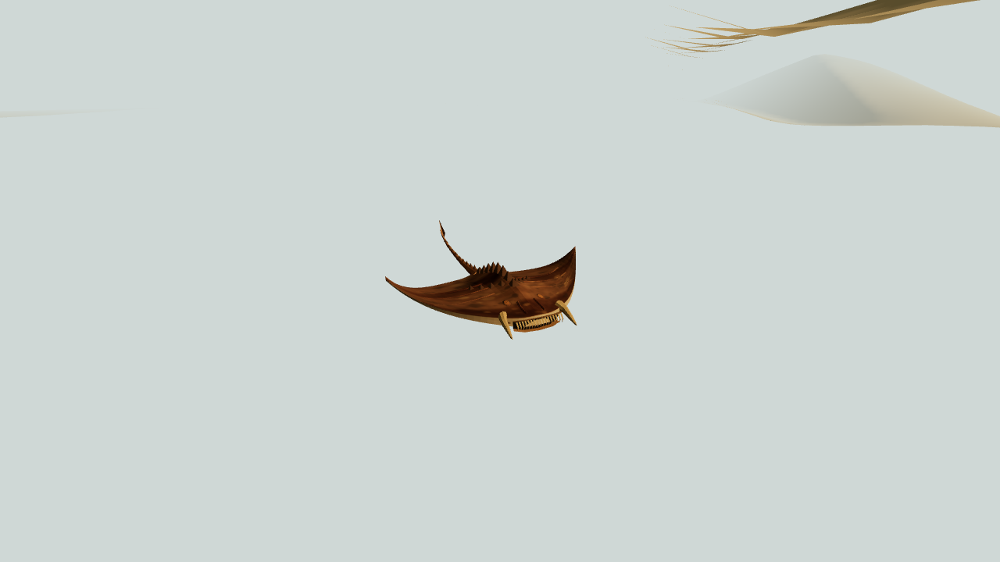 | 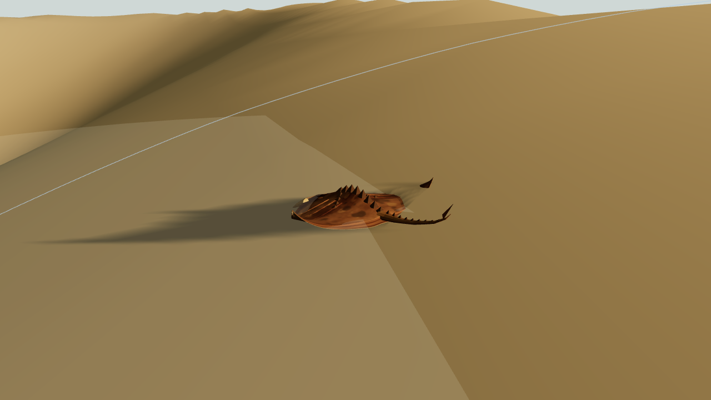 |
| Arraia-de-Areia sobre o relevo do hexágono DN_19. | Mergulho: o corpo atravessa a superfície da areia. |
| 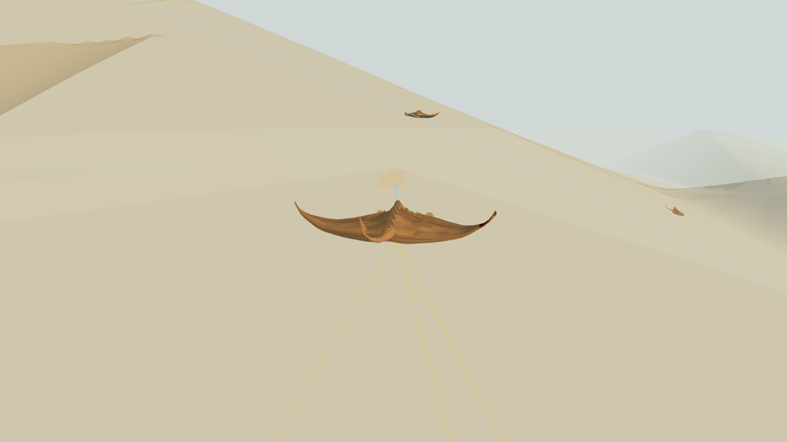 | 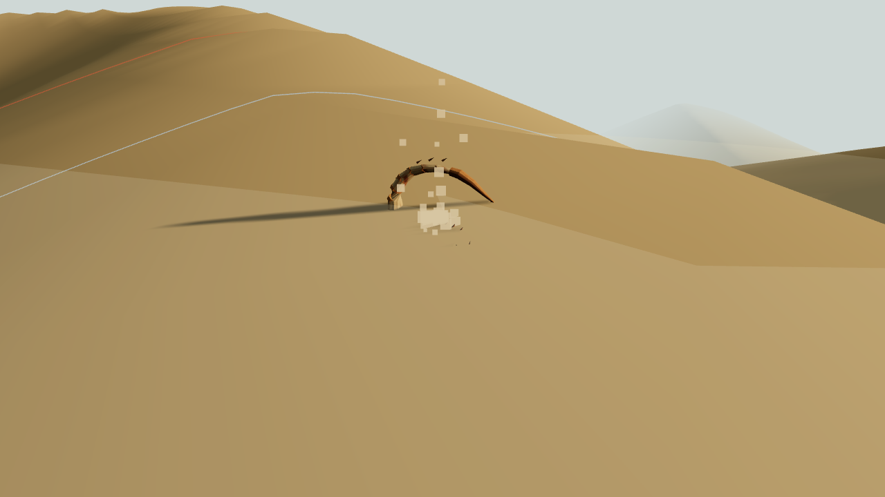 |
| Modo de inspeção: corpo a 1,6 m, linha de profundidade (azul) e linhas até os estímulos (laranja). | Emergência do Serracórion com areia deslocada. |
| 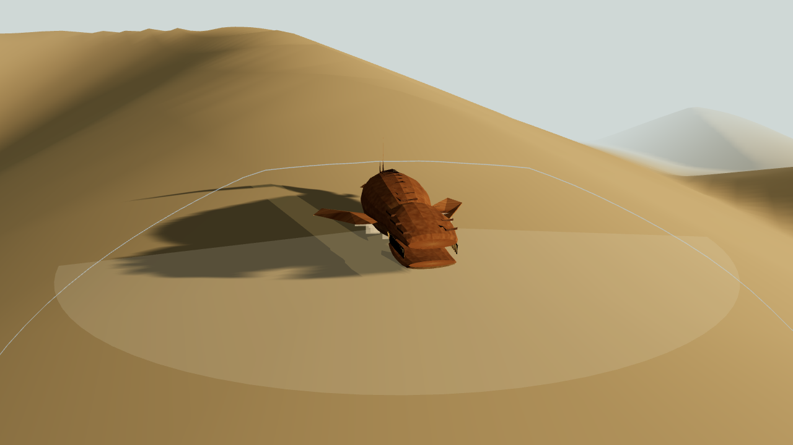 | 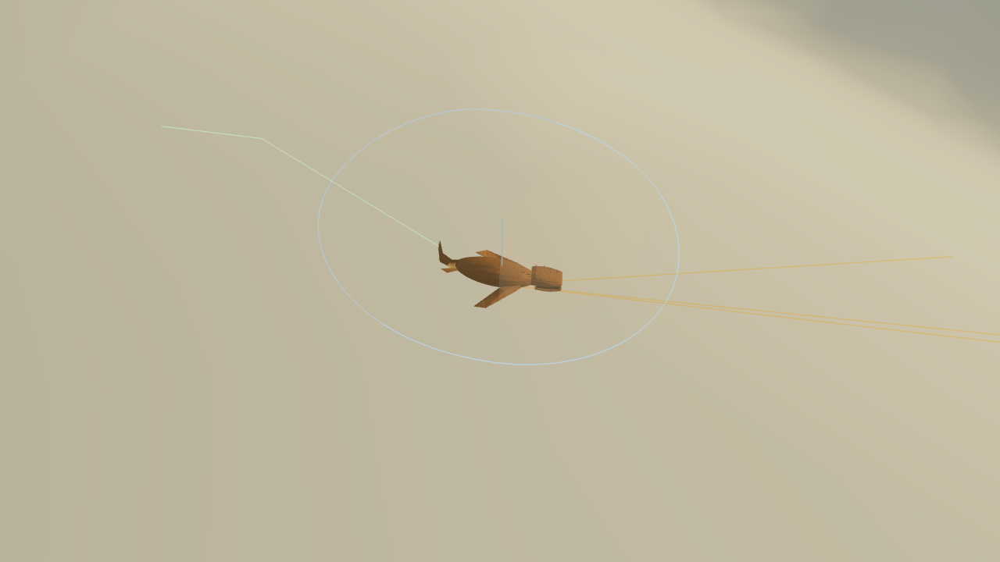 |
| Arenoceto (18 m) na areia, instantes antes de mergulhar. | Arenoceto a 12 m de profundidade, 3,9 m depois da divisa DN_22 \| DN_23, já na peça DN_23. |

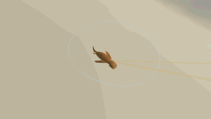

*Travessia subterrânea entre dois hexágonos oficiais vizinhos, 48 quadros do renderizador do laboratório.*

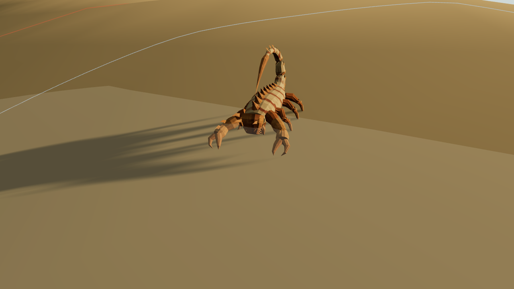

*Serracórion segurando pela pinça a Arraia que localizou pela vibração (cenário D, semente 3, t = 215,9 s).*

### Comandos

| O quê | Comando |
|---|---|
| Relatório dos cenários de dunas (3 sementes) | `node scripts/dunas-relatorio.mjs --sementes 1-3` |
| Derivar o terreno das megadunas DN_19 | `node scripts/derivar-corredor-hex.mjs --hexes DN_19 --x0 -1765.1 --z0 10950 --largura 600 --profundidade 600 --res 2 --saida config/eco/terrenos/dunas-dn19-interior.json` |
| Derivar o corredor da divisa DN_22 e DN_23 | `node scripts/derivar-corredor-hex.mjs --hexes DN_22,DN_23 --x0 -2565.1 --z0 15790 --largura 800 --profundidade 400 --res 2 --saida config/eco/terrenos/corredor-megadunas-dn22-dn23.json` |
| Testes das dunas | `node --test test/dunas-*.test.mjs` |

### Estado de cada requisito

| Requisito | Estado | Evidência |
|---|---|---|
| Arenoceto e Arraia se deslocam sob a areia | APROVADO | 1,1 a 11,7 km percorridos sob a areia por execução; `test/dunas-fisica.test.mjs` |
| Profundidade representada na simulação, não só na animação | APROVADO | `a.subsolo.prof` move o corpo e a altura; painel e capturas |
| Colisões e limites físicos | APROVADO | Testes de rocha, profundidade máxima e passagem estreita |
| Vibrações influenciam decisões reais | APROVADO | 18 a 524 investigações por execução; `dunas-percepcao.test.mjs` |
| Mergulho e emergência como ações físicas completas | APROVADO | Rampas lineares, sem salto; 1 a 152 mergulhos por execução |
| Interações ecológicas autônomas | APROVADO | Exploração, filtragem, descanso enterrado, caça, fuga e territorialidade sem comandos |
| Testes com as quatro espécies | APROVADO | Cenário E com as quatro, três sementes |
| GLBs originais intactos | APROVADO | SHA-256 no relatório; leitura apenas |
| Cenários antigos funcionando | APROVADO | 110 testes passam, incluindo a travessia SE para X7 |
| Testes automatizados e build | APROVADO | `npm test` 110/110, `npm run build` ok |
| Interface acompanha os animais | APROVADO | Inspeção subterrânea, ficha com meio, profundidade, vibrações e decisões |
| Capturas e animações reais | APROVADO | Sete capturas e um GIF do renderizador real |
| Dano entre superfície e subsolo | **PARCIAL** | 1 a 10 ataques e 0 a 3 ferimentos por execução no cenário D; a maioria dos botes é bloqueada pela areia ou esquivada. Falta calibrar o bote do Serracórion contra presa em fuga |
| Captura do Arenoceto emergindo | **PENDENTE** | Ele não tem clipe de locomoção de superfície e, nos cenários atuais, não teve motivo para emergir; a emergência está demonstrada com o Serracórion e a Arraia |
| Efeitos de areia na Alpha | **PENDENTE por decisão** | Experimentais, isolados no laboratório; não integrados |

### Limitações conhecidas

- O mapa de areia é **experimental**, derivado da malha: nenhuma peça oficial declara substrato.
- Escarvão e Serracórion não têm clipe de deslocamento subterrâneo contínuo; o laboratório repete
  `burrow`/`sand_dig`, identificado como fallback provisório na ficha e no inspetor.
- Nenhum número das quatro espécies vem de ficha aprovada: todos são provisórios.
- O custo por passo sobe quando muitas rotas no volume de areia são replanejadas ao mesmo tempo
  (pico de 2,3 ms/passo contra 0,70–0,86 ms/passo da linha de base da savana-viva).

## V4 — hexágonos reais do mundo e travessia da divisa

As criaturas andam sobre a malha dos **GLBs oficiais** do mundo, nas posições de
[`world/playable-eastern-range-v01/composicao_149_hex.json`](../../world/playable-eastern-range-v01/composicao_149_hex.json)
(escala em metros preservada), e **atravessam a divisa entre duas peças vizinhas** sem troca de terreno.

| O quê | Comando / endereço |
|---|---|
| Travessia da divisa (cenário pronto) | `npm run dev` → http://localhost:5180/ecossistema.html?cenario=travessia-divisa&semente=5 |
| Procurar um trecho caminhável numa divisa | `node scripts/derivar-corredor-hex.mjs --hexes SE,X7 --procurar` |
| Derivar o corredor usado pelo cenário | `node scripts/derivar-corredor-hex.mjs --hexes SE,X7 --x0 3930.1 --z0 2550 --largura 800 --profundidade 400 --res 1 --saida config/eco/terrenos/corredor-oasis-dunas-transicao.json` |
| Testes da travessia | `node --test test/eco-travessia.test.mjs` |
| Auditar a emenda no navegador | no console da página: `ecoDemo.auditarTravessia()` |
| Conferir SHA-256 e triângulos das peças da composição | `node scripts/derivar-corredor-hex.mjs --auditar-shas` → `resultados/v3/auditoria-hexes.json` |

**O percurso.** Corredor de 800 × 400 m a cavalo na divisa de duas peças vizinhas no mesmo Z:

| Peça | Id na composição | GLB | Centro (x, z) |
|---|---|---|---|
| Oásis das Dunas (dunas, oeste) | `SE` | `world/desert-ring/models/04_oasis_dunas.glb` | 2165,06 · 3750 |
| Oásis dos Contrafortes (**peça de transição** deserto→floresta, leste) | `X7` | `world/biome-continuity/models/15_oasis_transicao_5km.glb` | 6495,19 · 3750 |

A divisa fica em x = 4330,127 m do mundo (x = 400 m dentro do corredor, bem no meio da tela) e o corredor cobre
x 3930,1 → 4730,1 e z 2550 → 2950. O fundo é um vale seco e os dois lados sobem até ~50 m, então dá para ver o
relevo das duas peças de uma vez. No inspetor, cada animal mostra em que peça está e a quantos metros da divisa.

**Como funciona.** `scripts/derivar-corredor-hex.mjs` lê as peças (somente leitura), desloca cada uma pelo seu
`center_x`/`center_z` e rasteriza **as duas na mesma grade** de 1 m: altura, água, rocha, tronco e cobertura saem
dos mesmos GLBs que aparecem na tela. Para a simulação isso é um terreno só, então a travessia é só andar — posição,
direção e atividade seguem iguais, sem troca de terreno entre peças. `src/web3d/hexes3d.js` põe as peças na cena
nessas mesmas posições e carrega a vizinhança por proximidade (a peça sob a criatura antes do primeiro quadro; as
vizinhas quando o alvo da câmera chega a 350 m delas). A saia lateral do hexágono (`hex_side_cut`) fica escondida e
o `metalness` dos GLBs vai a 0 (metal sem mapa de ambiente renderiza preto). A leitura dos GLBs é compartilhada com
o recorte de um hexágono só em `scripts/lib-hex-glb.mjs`.

**Medido** (`resultados/v3/travessia-divisa.json`, cenário `travessia-divisa`, semente 5):

- Emenda: maior degrau de altura entre células de 1 m na coluna da divisa **0,042 m**, contra 4,85 m no corredor inteiro.
- Chão visível × grade da IA (raios verticais sobre a malha real, 40 m de cada lado da divisa): diferença **média 0,5 mm, máxima 8,5 mm**.
- Sem buraco: **779 pontos, 0 sem chão**. 19 raios precisaram de 1 mm de desvio porque caíram exatamente na linha de encontro das duas malhas (o raio escapa entre os dois triângulos por arredondamento) — a auditoria conta isso em `resgatados`.
- Patas: erro de altura com IK **0 a 10 mm** nos dois lados.
- Travessia: o Varrisco cruzou oeste→leste aos ~250 s e voltou leste→oeste aos ~307 s **perseguindo** (a atividade não reinicia); nenhum passo acima da corrida da espécie no `dt` (sem teleporte).

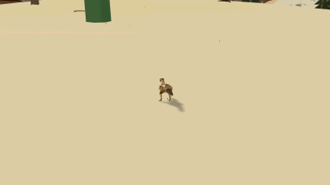

*O Varrisco cruzando a divisa de oeste para leste com a câmera acompanhando (16 s de simulação).*

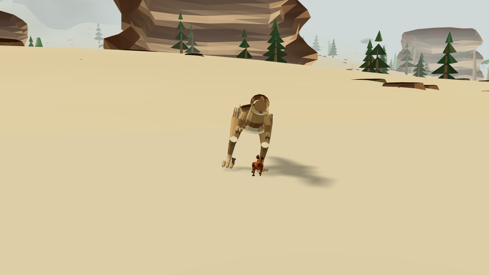

*Varrisco e Velsari a 10 m da divisa, já de volta no lado das dunas, com sombra projetada no chão da peça; ao fundo, as mesas e coníferas da peça de transição.*

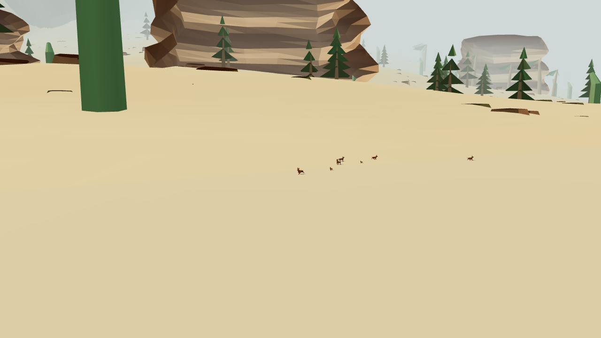

*O bando de Velsaris no fundo do vale, em cima da emenda das duas peças.*

### Correções desta rodada

- **SHA-256 das peças.** `node scripts/derivar-corredor-hex.mjs --auditar-shas` confere as 18 peças da composição
  que têm `source_sha256`: 7 batem e 11 divergem — as três de transição (`updated: true`) e as oito de floresta.
  Em **todas** elas a contagem de triângulos do arquivo é igual à da composição, então o que está desatualizado é o
  metadado (`source_sha256` é do arquivo-fonte antes da exportação final), não o GLB. Nenhum arquivo do mapa foi
  tocado; o terreno derivado grava o SHA-256 real de cada peça usada e o campo `confereSha`.
  Detalhe por peça em `resultados/v3/auditoria-hexes.json`.
- **Sombras sobre as peças.** A malha de um hexágono tem 4330×5000 m em triângulos de ~24 m; nessa escala a
  coordenada de sombra interpolada perde precisão e a sombra não aparece (medido com planos de teste no mesmo
  lugar: receptor de 14 m recebe sombra, de 5000 m não — e trocar material, normais ou tamanho do mapa de sombra
  não muda nada). `TapeteDeSombra` (`src/web3d/cena.js`) resolve: um retalho de 70 m do relevo, sem cor própria
  (`ShadowMaterial`), que acompanha o alvo da câmera e tira a altura da mesma grade que a IA consulta.

  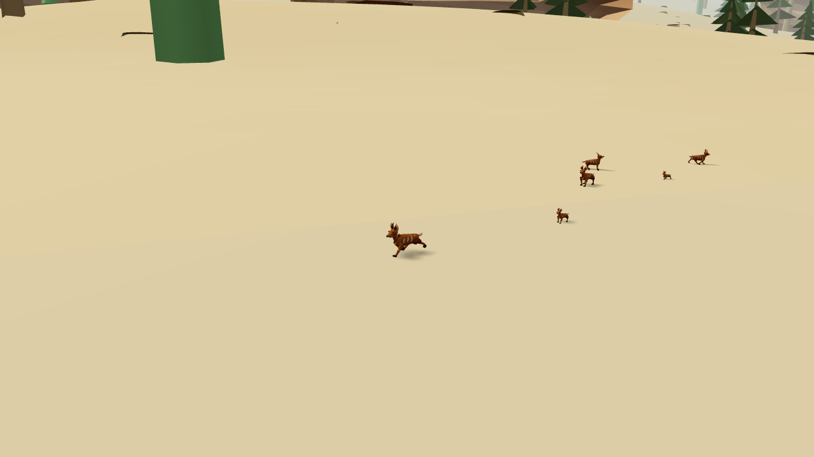

  *Bando de Velsaris com sombra projetada na areia da peça `SE`.*

- **Deslize das patas do Velsari em fuga.** Os clipes dos GLBs são lentos: o `flee` do Velsari avança 1,68 m/s na
  escala do modelo e a espécie foge a 9 m/s. Com o teto antigo de `timeScale` (2,5) o corpo ia 4,8–8,1 m/s mais
  rápido que as patas. O teto subiu para 6 (`TS_MAX_LOCOMOCAO` em `src/web3d/animador.js`). Mesma semente, mesmos
  210 s, câmera seguindo `velsari-1`: desencontro corpo×clipe **8,09 → 0,00 m/s**, deslize medido do pé no apoio
  **0,229 → 0,191 m/s**, liberações da trava do pé **181 → 131**. Acima de ~10,1 m/s ainda sobra desencontro, que
  o inspetor mostra em `desliza`.
- **Raios falhando na emenda.** `ecoDemo.auditarTravessia()` agora repete o raio com 1 mm de desvio quando ele
  passa exatamente pela aresta compartilhada: `semChao` caiu de 19 para **0** em 779 pontos, e os desvios aparecem
  em `resgatados`.
- **Peso dos dados.** `carregarConfigEco(lerJson, { preCarregarTerrenos: false })`: a página só busca o terreno do
  cenário escolhido. Abrir a Savana Viva deixou de baixar os 7,3 MB do corredor (medido na aba de rede: só
  `savana-bosques-acacia-rio.json`).
- **GLBs na hospedagem.** `npm run demo-hospedada` passa a exportar as peças de hexágono em base64 (como já fazia
  com os GLBs das criaturas) e `hexes3d.js` as lê por lá quando não está no servidor do laboratório. A travessia
  abre na versão hospedada com o chão real; `dist-eco/` foi de ~17 MB para 24 MB. Uma peça que falhe ao carregar
  agora fica marcada como `falhou` em vez de ser pedida de novo a cada 500 ms.

## V2 — ecossistema autônomo (resumo)

Progresso detalhado, decisões e limitações: [CHECKPOINT-V2.md](CHECKPOINT-V2.md). Resultados: [resultados/eco/relatorio.md](resultados/eco/relatorio.md).

| O quê | Comando |
|---|---|
| Demo 3D com GLBs reais (servidor local) | `npm run dev` → http://localhost:5180/ecossistema.html?cenario=bebedouro-real&semente=4 |
| Relatório do ecossistema (encontros + 2 anos de população) | `npm run eco` |
| Auditar GLBs (frente anatômica, root motion, velocidade natural dos ciclos) | `npm run auditar-glb -- ../../assets/models/creatures/varrisco` |
| Regerar perfis dos modelos | `npm run perfis-modelos` |
| Derivar recorte navegável de um hexágono real (somente leitura) | `node scripts/derivar-terreno-hex.mjs <hex.glb> --procurar` |
| Montar versão hospedada (`dist-eco/`) | `node scripts/montar-demo-hospedada.mjs` |

- Motor em `src/eco/`: espécies reais (Velsari, Cromátil, Tarruco, Varrisco, Rocantraz) em `config/eco/especies/`; terreno 3D e A*; percepção sobre o relevo; bandos; combate e disputas; saúde; ciclo de vida; níveis de simulação 1/2/3; persistência exata.
- Demo em `ecossistema.html` + `src/web3d/`. A orientação de cada GLB vem da auditoria (+X ou +Z), o que corrige a caminhada lateral. As demos `savana-real*.html` também foram corrigidas.
- Sem dependências npm; os GLBs são lidos dos caminhos originais (rota `/repo/`) e nunca copiados para o repositório.

Laboratório independente para desenvolver e testar a IA das criaturas do Wildhaven: percepção, memória da última posição conhecida, fome, energia e tomada de decisão. Funciona sozinho, sem depender da Alpha e sem dependências npm (só Node ≥ 22).

A **mesma lógica** (`src/core/`) roda na página visual e no simulador sem interface. Para a mesma configuração, cenário e semente, os dois produzem a mesma trilha de decisões. Isso é verificado por hash.

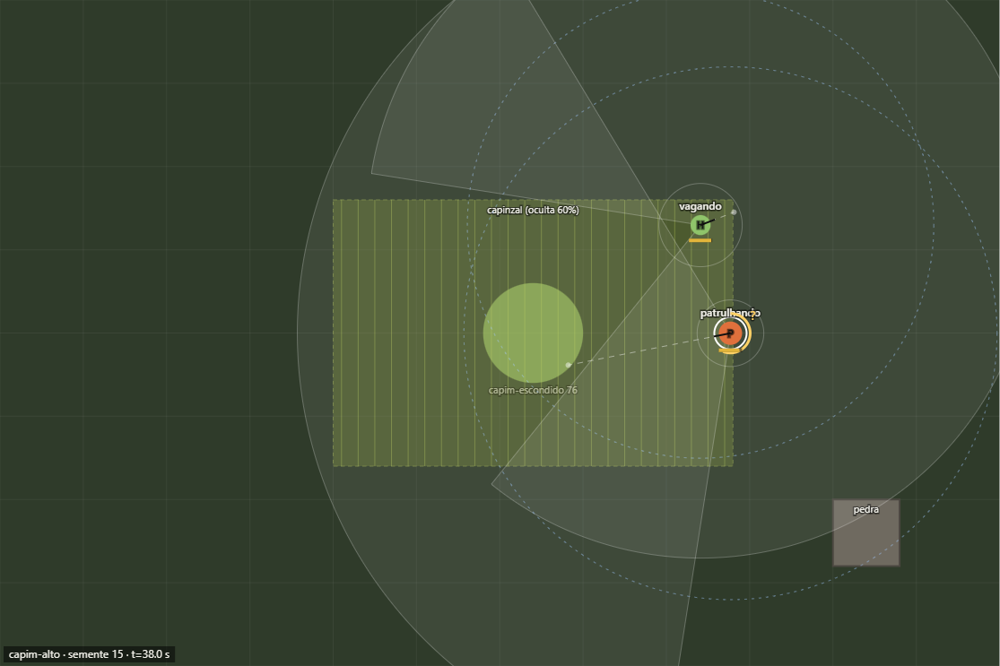

*Cenário `capim-alto`, semente 15, t = 38 s. Os dois passam a 6,7 m e nenhum percebe o outro. O predador chegou a 56% de atenção (arco amarelo), mas virou antes de reconhecer a presa. Para a presa, o predador está camuflado. O encontro termina sem detecção.*

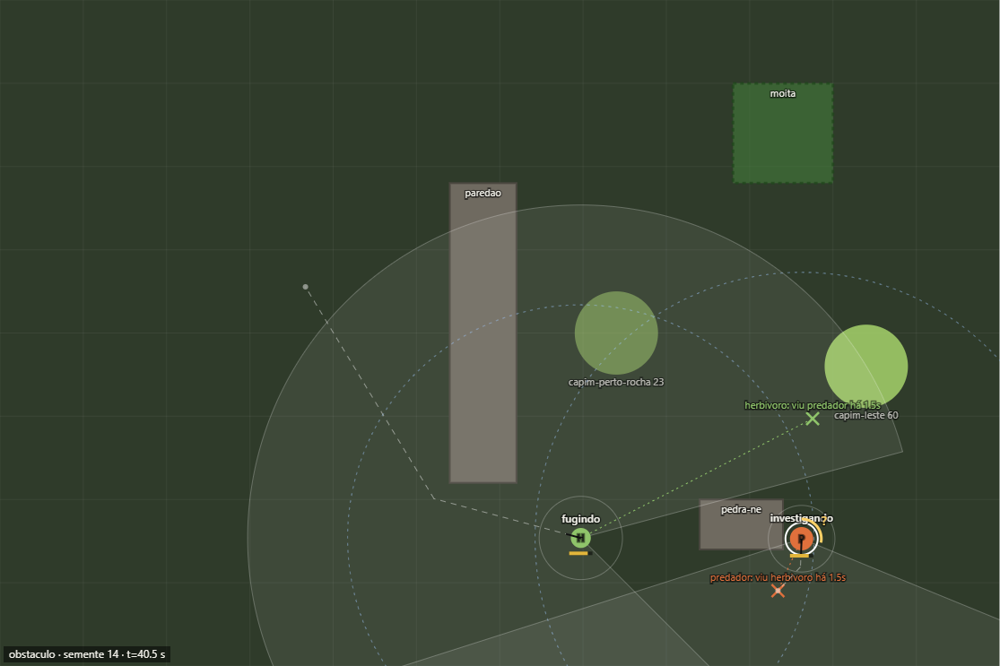

*Cenário `obstaculo`, semente 14, t = 40,5 s. A presa quebrou a linha de visão. O predador está `investigando` e vai até o **×** laranja, a última posição em que viu a presa, não até onde ela está.*

## Comandos (rodar dentro de `labs/ia-criaturas/`)

| O quê | Comando |
|---|---|
| Instalar | `npm install` (não há dependências; só cria o lockfile) |
| Abrir a página | `npm run dev` → http://localhost:5180/ |
| Abrir um encontro específico | http://localhost:5180/?cenario=obstaculo&semente=7 |
| Testes | `npm test` |
| Simular 30 sementes × cenário + relatório | `npm run simular` → `resultados/relatorio.md` e `resultados/resumo.json` |
| Reproduzir um encontro no terminal | `npm run reproduzir -- --cenario obstaculo --semente 7` (adicione `--eventos` ou `--json`) |
| Conferir a paridade página × CLI | `npm run paridade` e, no console da página, `laboratorio.impressaoDigital('1-30').hash` |
| Build estático | `npm run build` → `dist/` · prévia: `npm run preview` → http://localhost:5181/ |
| Tudo (testes + simulação + build) | `npm run verificar` |
| Ver os clipes reais de um GLB | `npm run clipes -- ../../caminho/do/modelo.glb` (aceita pasta) |

Parâmetros extras: `npm run simular -- --cenario obstaculo --sementes 1-100`; `npm run dev -- --porta 8080`.

## A página

- Escolha o **cenário** e a **semente**. 🎲 sorteia uma semente, e a URL sempre reflete o encontro atual (🔗 copia o link).
- **Iniciar/Pausar** (espaço), **+1 passo** (→), **Reiniciar** (R) e **velocidade** de 0,25× a 16×. A velocidade só muda quantos passos fixos de 0,1 s rodam por quadro, então a trilha não muda.
- **Clique num animal** para ver a atividade atual, a energia, a fome, o alvo, o **motivo da última decisão** (com o código), o que ele percebe agora, a memória e o clipe de animação sugerido.
- Camadas: cone de visão e círculo de audição, **última posição vista** (× com a idade da lembrança), linhas de contato (contínua = visão, pontilhada = audição), destino/waypoint e rastro.
- 📷 **Salvar PNG**: com `npm run dev`, grava em `resultados/capturas/`. Fora do servidor do laboratório, baixa o arquivo.
- API de automação no console: `window.laboratorio` (`reiniciar`, `avancar`, `avancarAte`, `rodarAteFim`, `hash`, `resumo`, `decisoes`, `selecionar`, `impressaoDigital`, `salvarCaptura`).

## Como a IA funciona

Cada passo (0,1 s) tem três fases, sempre na mesma ordem:

1. **Percepção** (`src/core/percepcao.js`)
   - Visão: cone, alcance e linha de visão, bloqueada por obstáculos com `bloqueiaVisao`. Também há visão de proximidade em 360°.
   - **Furtividade:** o alcance em que um animal é visto é `alcance × visibilidade`. A visibilidade é `(1 − furtividade.camuflagem)` × `fatorParado` (se estiver imóvel) × `(1 − ocultacao)` de cada trecho de capim alto na linha entre os dois.
   - **Reconhecimento gradual:** dentro desse alcance efetivo, a atenção sobe até 100% em cerca de `visao.tempoReconhecimentoSeg` (mais rápido de perto). Só então vira contato. Se o observador desvia o olhar, a atenção cai.
   - A página mostra a atenção parcial como um arco amarelo com "?". O inspetor lista "No alcance, mas não vê", com o motivo, e a visibilidade de cada animal.
   - Audição: o alcance é proporcional ao ruído, ou seja, à velocidade relativa à corrida, multiplicada por `furtividade.ruidoPassos` (patas macias < 1). Obstáculos no caminho abafam o som (`atenuacaoSom`).
   - O estado modifica os alcances. Por exemplo, comendo, o animal vê menos.
   - A memória guarda a última posição conhecida e expira em `memoriaSeg`.
2. **Decisão** (`src/core/comportamentos/`): o cérebro recebe **apenas** `sentidos` (`eu`, `contatos`, `memoria`, `terreno`, `rng`), nunca o mundo. Há um teste garantindo isso, e o mundo valida que todo alvo veio da percepção ou da memória (falha `reagiu_sem_perceber`).
   - **Herbívoro**: foge do que vê. Se só ouviu, fica em `alerta`, a não ser que o som esteja muito perto. Continua fugindo da última posição lembrada até passar `tempoCalmaSeg` sem sinal **e** estar a `distanciaSegura`. Depois passa por `recuperando` e volta a comer ou vagar. Quando está faminto, vai ao alimento lembrado mais próximo. A fuga prefere pontos que quebram a linha de visão.
   - **Predador**: `patrulhando` → `aproximando` (anda devagar, faz menos ruído) → `perseguindo` (corre e mira à frente da presa) → `atacando` (dentro do alcance, com chance e recarga). Se perde a visão, passa a `investigando` e vai à última posição conhecida, depois `farejando`. Desiste por **perda de rastro** (`tempoSemContatoMaxSeg`) ou por **cansaço** (`energiaDesistir`). Com fome desesperada, caça mesmo com pouca energia. Depois de desistir por cansaço, só volta a caçar quando recuperar até `energiaRetomar`.
3. **Ação**: locomoção com giro limitado, aceleração e navegação que contorna obstáculos com `bloqueiaMovimento`. Inclui colisão, gasto e recuperação de energia, aumento da fome, ato de comer e ataque.

**Determinismo:** todo sorteio usa `src/core/rng.js`, com um fluxo por criatura derivado da semente. A trigonometria usa `src/core/matematica.js` (só + − × ÷ e `sqrt`), porque `Math.sin/cos/atan2/hypot` dão resultados ligeiramente diferentes entre o V8 do Node e o do Chrome. Isso foi observado e corrigido aqui: `obstaculo`, semente 2, divergia. Um teste impede o uso dessas funções em `src/core`.

## Configuração (tudo editável, sem mexer no código)

- `config/indice.json`: quais espécies e cenários são carregados.
- `config/especies/*.json`: arquétipo (`comportamento`), corpo, movimento, percepção, necessidades, ataque, relações (`teme`, `presas`, `come`), limiares de decisão, `modelo.glb` e `modelo.clipes` (estado → nome do clipe no GLB). O campo **`balanceamento.provisorios`** lista os valores provisórios de balanceamento, que também aparecem no relatório.
- `config/cenarios/*.json`: terreno, obstáculos (`bloqueiaVisao`, `bloqueiaMovimento`, `atenuacaoSom`, e `ocultacao` para capim alto que oculta sem bloquear), alimentos, criaturas (posição, `variacaoPos`, direção, energia e fome iniciais) e rota de patrulha. Sem `patrulha`, a rota é sorteada pela semente.

### Cenários

| Cenário | O que testa |
|---|---|
| `campo-aberto` | Encontro direto, os dois descansados. |
| `obstaculo` | Rocha entre os dois; a presa pode quebrar a linha de visão. |
| `predador-cansado` | O predador começa faminto e com pouca energia. |
| `territorios-separados` | Terreno de 120×80 m, cada um no seu canto: encontros que **não** acontecem. |
| `capim-alto` | A presa come dentro do capinzal; o predador segue uma rota sorteada: camuflagem, imobilidade e quase-encontros. |
| `aproximacao-furtiva` | O predador atravessa uma faixa de capim até a presa: quem detecta primeiro e a que distância. |
- Um arquétipo novo é um módulo em `src/core/comportamentos/` com `decidir(sentidos, mente)` registrado em `index.js`.
- Os GLBs são referenciados pelo caminho original, sem cópia. Quando o laboratório está em `<repo>/labs/ia-criaturas`, o servidor expõe a raiz do repositório em modo somente leitura em `/repo/<caminho>`, apenas para assets (`.glb`, `.gltf`, `.bin`, imagens, `.json`, `.md`). Por exemplo, `/repo/creatures/.../modelo.glb`. Use `--raiz-repo <pasta>` se o laboratório estiver em outro lugar.

As espécies atuais são **exemplos genéricos** (`herbivoro-exemplo`, `predador-exemplo`). Veja [ESCOLHA-DAS-CRIATURAS.md](ESCOLHA-DAS-CRIATURAS.md) para trocá-las pelas espécies reais do Wildhaven.

## Resultados

[`resultados/relatorio.md`](resultados/relatorio.md) traz 30 sementes por cenário, com:
- Encontros sem detecção, perseguições, fugas, desistências, capturas e duração das perseguições.
- Uma semente de exemplo por resultado e as falhas.
- Uma seção de **furtividade**: quase-encontros, quem detectou primeiro, distância da primeira detecção e tempo em que cada animal teve o outro no alcance sem vê-lo, por motivo (sem linha de visão, fora do cone, camuflagem/cobertura, reconhecendo).

Capturas da página em execução ficam em `resultados/capturas/`.

### Encontros para assistir

**Quase-encontro no capim alto.** Hash `4e34e500`.

```bash
npm run reproduzir -- --cenario capim-alto --semente 15
```

Abra http://localhost:5180/?cenario=capim-alto&semente=15 e clique no predador. Por volta de 38 s ele passa a 6,7 m da presa. O arco amarelo enche até cerca de 56%, ele vira para o próximo ponto da patrulha e a atenção se esvai. No inspetor, "No alcance, mas não vê" mostra o motivo de cada um. O encontro termina sem nenhuma detecção.

**Perda de contato atrás da rocha.** Hash `d528e4ed`.

```bash
npm run reproduzir -- --cenario obstaculo --semente 14
```

Aos 20,5 s a presa vê o predador e foge sem que ele a tenha visto. Aos 38 s ele a vê, persegue e a perde de vista em 39,1 s. Então vai até o ×, fareja e desiste por perda de rastro em 44,1 s. Na segunda tentativa, aos 64,7 s, ele a captura.
