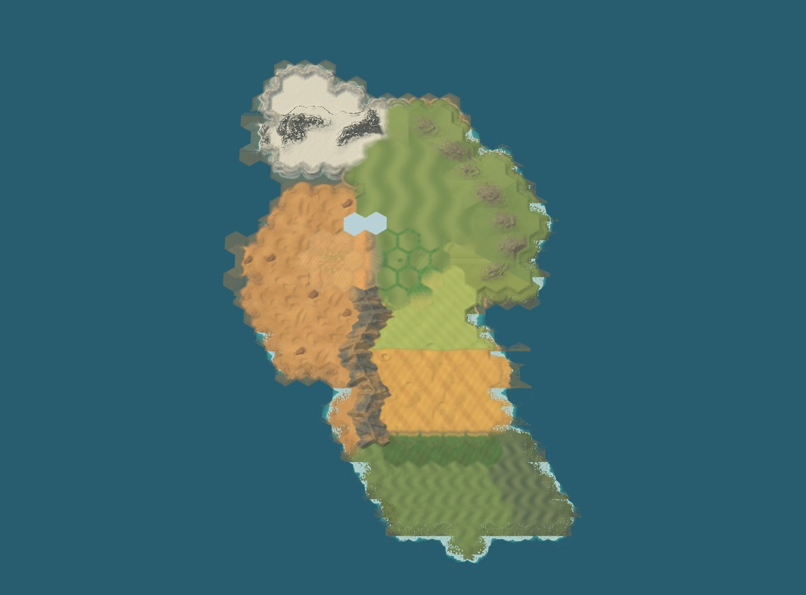
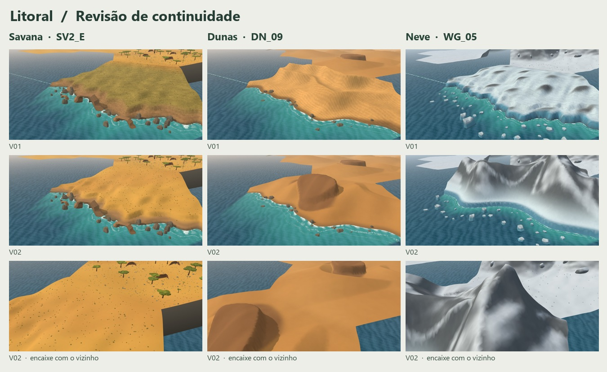

# Wildhaven · Litoral de Auralis

O mapa reúne **195 hexágonos originais e 77 costeiros**. O diretor aprovou os cinco protótipos, com praia e falésia na V01 e savana, dunas e neve na V02. A expansão acrescenta 72 modelos para revisão artística. [Abrir continente em 3D](http://127.0.0.1:8816/viewer/continente.html) · [Inspecionar a foz](http://127.0.0.1:8816/viewer/continente.html?trecho=costa_%2B05_%2B05)



O mapa abre com o relevo continental simplificado. Ao aproximar a câmera ou escolher um trecho no menu, o visualizador carrega os GLBs detalhados ao redor do ponto observado. O catálogo registra coordenadas, biomas, contatos, arquivo, SHA-256, bytes, vértices e triângulos de cada peça. [Catálogo das 77 peças](viewer/continente/composition.json)

| Junção | Faces | Pares de vértices | Maior distância 3D |
| --- | ---: | ---: | ---: |
| Continente e litoral | 148 | 10.804 | 1,001 mm |
| Peças costeiras entre si | 84 | 6.132 | 0,155 mm |
| Litoral e plataforma oceânica | 15 | 1.095 | 1,729 mm |

O teste reimporta os arquivos e mede as bordas em coordenadas de mundo. A maior diferença vertical foi de 0,046 mm e a maior diferença de cor foi de 0,0426 por canal RGB linear. Seis setores de plataforma prolongam no oceano as extremidades emergentes de três protótipos aprovados. A batimetria contínua cobre esses setores e alimenta a espuma e a cor da água. [Medições por face](tests/continente.json)

Os 77 GLBs costeiros e as duas malhas auxiliares passaram pelo Khronos Validator. Os dois carregadores Three.js, do mapa e da Alpha, abriram as 77 peças no navegador. O teste também abriu a vista geral e aproximou a câmera da foz. A taxa de quadros em dispositivos de jogadores ainda precisa de medição. [Validação glTF](tests/continental-gltf.json) · [Carregamento WebGL](tests/continental-loaders.json)

## Os cinco protótipos aprovados



O solo seco da savana recebe a cor do terreno de SV2_E. Na faixa de 650 a 1.750 m para dentro da costa, sua cor mediana por vértice passou de (0,400; 0,329; 0,098) para (0,694; 0,396; 0,090) em RGB linear. A mediana de SV2_E é (0,702; 0,408; 0,090). A topografia e os arcos da savana foram preservados.

O gerador das dunas amostra o relevo e a areia de DN_09. A crista em crescente conserva a face íngreme e a face longa de subida, com descida até a praia. Na neve, o gerador amostra altitude e cor de WG_05, desloca e gira o trecho de encosta e o adapta à frente glacial. A nova peça chega a Y = 1.289,54 m, ante 354,30 m na V01. A montanha original chega a 1.762,17 m.

| Protótipo e prévias | Hex externo (q, r) | Contatos reais | Triângulos no arquivo | Triângulos com instâncias |
| --- | --- | --- | ---: | ---: |
| [Glacial](models/glacial-v02.glb) · [vistas](preview/glacial-v02) | 0, −7 | WG_05 | 27.924 | 27.924 |
| [Praia de planície](models/praia-v01.glb) · [vistas](preview/praia) | 5, 3 | PL_E_E, PL_E_S, PL_E_SE | 28.670 | 104.000 |
| [Dunas](models/dunas-v02.glb) · [vistas](preview/dunas-v02) | −4, 0 | DN_09 | 26.580 | 26.580 |
| [Falésia de selva](models/falesia-v01.glb) · [vistas](preview/falesia) | −4, 13 | JS_-3_12, JS_-3_13 | 31.084 | 558.840 |
| [Arcos da savana](models/arcos-v02.glb) · [vistas](preview/arcos-v02) | 5, 6 | SV2_E | 27.680 | 40.760 |

## Planta e investigação

O mapa marcado inclui o sul tropical. A base é a composição de 195 peças do PR 100, revisão `a09d24d37e07beada8d9ddc680d4af305073be52`. Ela reúne o mundo v12 de 170 peças, a Vila dos Hunters e 24 peças de selva e pântano. A consulta às duas branches principais e às branches de terreno identificou também o estudo glacial v10, a reconstrução das megadunas e a região jogável oriental. Os GLBs de contato são os da composição de 195. [Mundo v12](https://github.com/carioca1111/wildhaven/pull/87) · [estudo glacial](https://github.com/carioca1111/wildhaven-new/pull/33) · [vila](https://github.com/carioca1111/wildhaven-new/pull/99) · [sul tropical](https://github.com/carioca1111/wildhaven-new/pull/100).

O preenchimento a partir do exterior da grade identificou **71 hexágonos continentais, 148 faces expostas e 77 posições costeiras**. As posições internas vazias (2, −2) e (3, −2) ficam fora do oceano. As 77 posições incluem os cinco protótipos. A categoria predominante de cada posição produz 15 glaciais, 11 praias, 19 dunas, 28 falésias e quatro costas de arcos. O inventário conserva a classificação de cada face nas posições mistas. A escolha das transições entre as pinceladas do diretor é uma interpretação do desenho.

- A [planta vetorial ampliável](preview/perimetro.svg) e a [planta PNG](preview/perimetro.png) identificam os hexágonos originais por ID e os propostos por coordenadas axiais. Os cinco contornos escuros indicam as malhas produzidas.
- O [levantamento](perimetro.json) registra IDs, biomas, SHA-256, centro, lado de conexão, contagem de amostras, extremos de altura e contatos com malhas de água.
- A geometria usa 5.000 m entre pontas norte/sul, raio de 2.500 m e apótema de 2.165,064 m. X/Z são horizontais e Y é altitude. O centro fica em X = 2A(q + r/2), Z = 3.750r. O carregador instancia cada GLB local no centro do hex.
- O enquadramento da planta usa o norte no topo. A projeção aproximada para a referência de 589 × 636 pixels está em [perimeter.py](tools/perimeter.py), junto às pinceladas digitalizadas. A medição de encaixe usa os centros do manifesto e os vértices 3D.

## Geometria, água e transições

As oito faces de contato incorporam a polilinha do GLB vizinho, as cores efetivas e a inclinação das faces adjacentes. O relevo próprio ganha peso dentro da peça nova. As duas texturas PNG presentes em cada GLB tratam o substrato e a superfície de gelo ou rocha. Os modelos incluem UVs. A costa curva atravessa o interior do hex e o fundo continua abaixo da água.

| Trecho | Forma produzida | Variação prevista na expansão |
| --- | --- | --- |
| Glacial | Contraforte de WG_05 com rocha exposta, calha de neve, frente de gelo e blocos flutuantes | Reduzir o gelo à medida que cascalho, rocha e areia temperada ganham espaço |
| Praia | Enseada com areia úmida, cordão de areia, encosta gramada e folhosas da biblioteca da vila | No norte temperado, aumentar vegetação de restinga e ajustar a descida da serra. Na planície, manter a praia aberta |
| Dunas | Crista em crescente e faces de deslizamento derivadas de DN_09. Rocha aflora junto à água | Conservar as grandes cristas no oeste e expor o maciço ao sul. Afinar as cristas onde chegam às plataformas rochosas |
| Falésia | Duas bancadas de erosão, pilhas rochosas, cavidade passante e dossel instanciado da selva vizinha | Temperada com musgo e folhosas, planície com capim, savana mais seca e selva com raízes e dossel. O trecho pantanoso pede cotas e drenagem próprias |
| Arcos | Três vãos de tamanhos diferentes, com pés apoiados no leito, bancos de maré, canais e moitas da savana | Passar da savana à selva conservando a rocha e aumentando sombra, umidade e cobertura vegetal |

O visualizador continental carrega GLBs pelo GLTFLoader e usa uma cor de fundo. Rios, lagos e pântanos têm superfícies locais nas peças existentes. O levantamento encontrou cotas nas faces externas entre −257,335 m em WG_18 e 2.261,770 m em JS_-3_10. Adotamos **Y = −270 m** como cota experimental de mar, abaixo de todas as amostras externas. O visualizador desenha uma única superfície nessa cota. A textura batimétrica deriva do fundo exportado e controla água rasa, água profunda e espuma. A ondulação é visual. Os cinco GLBs contêm terreno e formações, com a superfície oceânica fornecida pelo visualizador.

A água do rio de SV_E encontra a face leste a 446,843 m. Na peça externa (5, 5), a água percorre 3,05 km até o mar a −270 m. O perfil usa 123 seções e coincide com os nove vértices da saída do rio original com erro máximo de 0,797 mm. [Render da foz com a peça vizinha](preview/continente/foz.jpg)

## Validação dos cinco protótipos

O [manifesto](manifest.json) contém bytes, SHA-256, vértices, triângulos, instâncias, cotas e medições por vizinho. A verificação recalcula os 71 hashes de origem contra os manifestos fixados. Nas oito interfaces há 73 pares de vértices por face. As mesmas subdivisões lineares unem os pares nos dois lados.

| Medição | Resultado V01 |
| --- | --- |
| 584 pares de vértices | Maior diferença vertical de 0 m. Maior distância 3D de 0,000310 m |
| Derivada transversal | Maior diferença angular de 2,32° entre faces adjacentes |
| Cor na divisa | Maior diferença de 0,001954 por canal linear. A textura do substrato fica branca no contato |
| Topologia do terreno | Área integral do hex, faces ascendentes, sem degenerações nem bordas abertas internas |
| Formações sólidas | Malhas soldadas por posição para medir fechamento. Separação dos volumes por projeção convexa. Gelo flutuante acima do leito, rochas ancoradas e abertura dos arcos verificada por interseção |
| Vegetação | Raízes conferidas sobre os triângulos exportados. Raio conservador das copas contido no hex |
| Integridade glTF | Cinco arquivos com zero erros e zero avisos no [Khronos glTF Validator](tests/gltf.json). Os informes incluem textura de tamanho não potência de dois e extensão de instanciamento sem análise pelo validador |
| Compatibilidade | Dez carregamentos WebGL com GLTFLoader r181. Os cinco GLBs abriram tanto com a biblioteca do mapa quanto com a instalada pela Alpha. O [registro](tests/loaders.json) identifica o hash lido pelo navegador |
| Previsão de custo | A selva é a mais pesada, com 558.840 triângulos desenhados contando 1.463 instâncias. A revisão não mediu FPS no jogo |

As imagens mostram a iluminação e a água do visualizador de revisão. As formações e a vegetação são as do arquivo recarregado. As vistas **superior** e **encaixe** incluem a topografia existente ao fundo. As faces externas livres das cinco amostras ficam visíveis em alguns enquadramentos. Os testes de separação cobrem formações sólidas e apoios das plantas. Sobreposição natural entre copas, colisão de jogador, navegação e movimento de maré ficam fora dessa medição.

## Reproduzir

Use Python com NumPy, SciPy, Pillow e Matplotlib em um checkout da branch com as pastas v12, vila e sul tropical. Em um worktree esparso, defina `WILDHAVEN_BASE` como a raiz do checkout da composição de 195. O resolvedor existente recupera por hash os modelos detalhados da v12. O visualizador de revisão usa as bibliotecas Three.js já fornecidas com o mapa. Execute a partir de `world/coast-v01`.

```sh
python tools/perimeter.py
python tools/build.py
python tests/validate.py
python tools/serve.py
```

Abra [o visualizador local](http://127.0.0.1:8816). A câmera orbita com o mouse. O menu alterna protótipo e vista. Com o servidor em execução, rode `node tests/render.cjs` e `python tools/gallery.py` para recriar as 12 vistas revisadas e a prancha comparativa. O teste usa Playwright e Edge, com `PLAYWRIGHT_PATH` opcional e `CHROME_CHANNEL` para selecionar outro canal Chromium. Para testar a biblioteca da Alpha, instale as dependências da sua revisão com o lockfile em `game/alpha01`. O teste Khronos usa `node tests/gltf.cjs` com `gltf-validator@2.0.0-dev.3.10` resolvível localmente, ou com `GLTF_VALIDATOR_PATH` apontando para o pacote.

## Reproduzir a expansão

Com as cinco peças aprovadas disponíveis no diretório de modelos, execute a partir de `world/coast-v01`.

```sh
python tools/continent.py
python tests/check_continent.py
node tests/gltf.cjs --continente
```

Com o servidor local ativo na porta 8816, `node tests/continent.cjs` testa os dois carregadores e captura as prévias do continente e da foz. A avaliação artística das 72 peças novas é a etapa pendente desta entrega.
