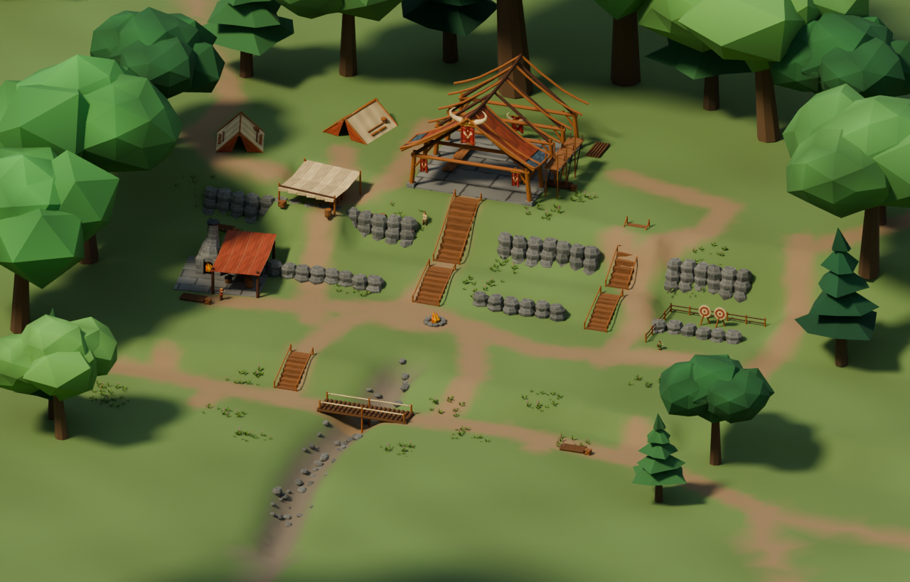
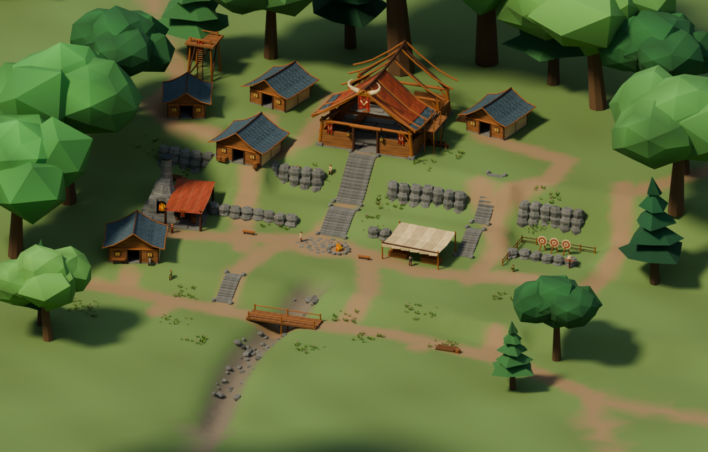
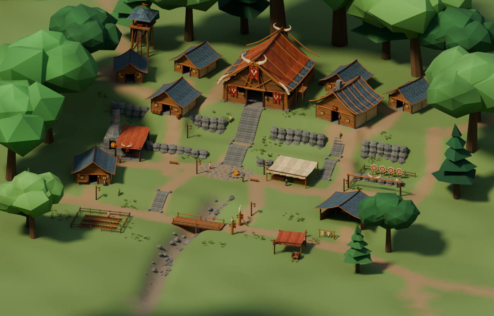
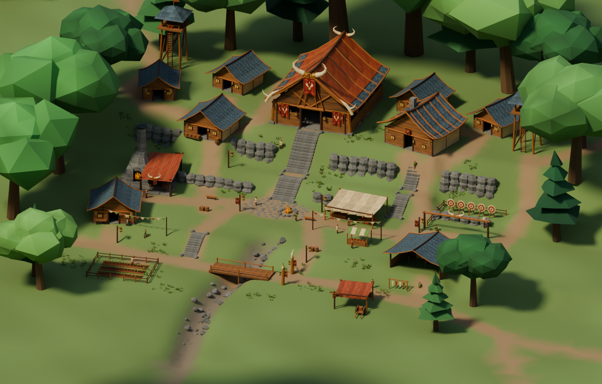

# Wildhaven · Vila dos Hunters

`HV_01` ocupa a lacuna oriental do mundo **v12 de 170 hexágonos**. A composição integrada tem **171 peças e 443 ligações**. O salão, a forja e as moradias evoluem nos mesmos lotes. Um terreno de 5 km e uma floresta são comuns às quatro fases.

| Fase 1 · Acampamento | Fase 2 · Expansão |
| --- | --- |
|  |  |
| **Fase 3 · Vila estabelecida** | **Fase 4 · Vila completa** |
|  |  |

As quatro imagens usam a mesma câmera e foram renderizadas no Blender a partir dos GLBs. A planta permite conferir as entradas, a praça, a ponte e as escadarias. [Planta da vila](preview/top.png) · [Localização no mundo completo](preview/mapa_171.png)

## Abrir

- **Blender 5.3** — abra [Wildhaven_Vila_Hunters.blend](Wildhaven_Vila_Hunters.blend). As texturas estão empacotadas. A quarta fase começa visível. Para comparar, alterne as coleções de fase no Outliner e mantenha a coleção de terreno ativa.
- **Alpha** — execute `npm ci` e `npm run dev` em `game/alpha01`. Abra `/?regiao=vila-hunters` no endereço do Vite. O pacote carrega os GLBs da fase selecionada. O panorama de 170 hexágonos, seus módulos de visualização e os seis vizinhos detalhados acompanham este PR em `world/world-visual-coherence-v12/`. As vistas da Alpha carregam esses binários locais. A origem de cada peça está registrada em [base-source.json](base-source.json).
- **Visualizador independente** — na raiz da entrega, execute `py tools/serve.py --port 8799` e abra [a vila no navegador](http://127.0.0.1:8799/world/hunters-village-v01/viewer/). O servidor confere SHA-256 antes de usar os arquivos da v12. Se for solicitada uma das outras 164 peças em detalhe, ele pode recuperá-la do Git original usando as credenciais do usuário e mantê-la em cache. Em Linux ou macOS, use `python3` no lugar de `py`.

Arraste para orbitar, use a roda para aproximar e selecione **Caminhar pela vila** para andar com WASD. A vista **Passagem para FX_20** permite atravessar a divisa. O modo continental enquadra as 171 peças e marca o novo hexágono em dourado.

## Terreno e floresta

O terreno usa coordenadas axiais `q=7, r=-1`, com centro continental glTF `[28145.825623, 0, -3750]` em metros. A distância entre as pontas norte e sul é 5.000 m. A composição de origem é `world-visual-coherence-v12`, commit `5865b5d0e92ec3eef541bfb51f3c1d9d7cbeb258` de `carioca1111/wildhaven`. O pacote novo pertence a `carioca1111/wildhaven-new`.

O hexágono estava vazio. O relevo interno interpola os seis perfis de contato e suas inclinações. O modificador **Relevo e patamares** constrói a superfície no Blender com `Set Position`, ruído multiescala e uma máscara que protege as bordas. Uma segunda máscara limita a terraplenagem ao núcleo da vila. As trilhas alcançam os seis lados. A ponte cruza uma grota seca. Os GLBs vizinhos não trazem curso de água para essa célula.

O modificador **Espécimes temperados** distribui cinco folhosas e três coníferas extraídas do GLB detalhado `FX_20` da v12. As cópias preservam a malha e a paleta dos exemplares. A escala diminui na orla da vila. O gerador exclui trilhas, lotes e copas que ultrapassariam a borda. Semente, densidade e porte podem ser editados no grafo. Os oito protótipos estão identificados por componente e raiz de origem em [site.json](site.json).

## Progressão e modelos

| Fase | Lotes ativos | Mudança física |
| --- | ---: | --- |
| 1 | 6 | Salão em obra, forja aberta, barracas, depósito provisório e alvos. |
| 2 | 10 | Oficina, mercado, mais uma casa, torre, paredes permanentes e cobertura em construção. |
| 3 | 15 | Taverna, estábulos, caravana, horta, outra casa, lanternas e patamares equipados. |
| 4 | 16 | Salão fechado sob a cumeeira, chifres esculpidos, segunda torre, banca adicional e praça cerimonial. |

Cada fase tem um GLB de exteriores, um LOD de distância e um GLB de interiores. Os 16 edifícios e instalações finais também estão disponíveis individualmente com origem local. Os arquivos incluem materiais PBR, UVs, tangentes e o atlas compartilhado. Os habitantes posados dão escala à prévia e estão identificados pelo extra `role=preview-residents` para substituição por NPCs do jogo. [Construções](models/buildings/) · [Texturas](textures/) · [Progressão e desbloqueios](progression.json)

## Integração

1. Leia [composition_171.json](composition_171.json). Mantenha as transformações continentais. Para as 170 peças de origem, cada `model_url` usa a rota local que resolve o GLB exato da revisão fixada. Para a vila, carregue o terreno, a floresta e a fase ativa sob **uma** transformação `worldCoord`. Os GLBs da vila contêm alturas locais absolutas em metros. Aplique somente a translação horizontal do hexágono.
2. Use [runtime.mjs](runtime.mjs) para trocar a fase, descartar solicitações superadas e liberar geometrias e texturas. A vista próxima carrega o interior e os exteriores da fase atual. O modo continental usa LODs de terreno, bosque e construções. A inspeção regional carrega os vizinhos detalhados sob demanda.
3. Conserve `village.phase` e a posição na instância da conta. O adaptador local usa a chave `wildhaven.village.HV_01.<conta>`. Na Alpha, acrescente `&conta=<id>` à rota da vila. No visualizador, use `?conta=<id>`. A persistência demonstrada é local a este navegador. Em produção, o host autenticado deve fornecer a identidade e seu próprio adaptador de leitura e gravação.
4. Use os volumes de colisão dos lotes e das estruturas públicas, os pisos, a ponte e os degraus de [progression.json](progression.json). Os caminhos para os NPCs em [navigation.json](navigation.json) chegam às entradas de cada fase por coordenadas locais glTF. O campo de custos está reservado para a economia futura.
5. Para um espelho da v12 na Alpha, configure `VITE_WILDHAVEN_V12_URL` com a raiz HTTP que contém `detailed/` e `models/`. O servidor independente aceita `--world CAMINHO` para uma cópia local de `world-visual-coherence-v12`.

## Reprodução e conferência

O preparo usa Python 3.11+ com NumPy, SciPy e Pillow. O teste geométrico também usa Matplotlib. Os scripts Blender usam o Python incluído no Blender 5.3.

```sh
python tools/base_world.py
python tools/prepare.py
python tools/atlas.py
blender -b --python-exit-code 1 -P tools/build.py
python tools/forest.py
python tests/geometry.py
blender -b --python-exit-code 1 -P tests/blender_check.py
blender -b --python-exit-code 1 -P tools/render.py -- --shots 1 2 3 4 top --width 1280 --samples 12
```

O validador Khronos é executado por `node tests/validate-glb.mjs`. Instale `gltf-validator` ou indique o pacote com `GLTF_VALIDATOR_PACKAGE`. O teste `node tests/browser.mjs` usa o visualizador local, Node 22+ e Chrome. Defina `CHROME` para usar outro executável Chromium.

Os testes verificam os GLBs exportados, o efeito do modificador no arquivo reaberto, as raízes, as copas, as seis bordas, as rotas dos lotes, o caminhamento, o LOD, a troca de fases e o estado por conta. [Relatório técnico](REPORT.md) · [Inventário binário com SHA-256](manifest.json) · [Geometria e costuras](tests/geometry.json) · [Validador glTF](tests/gltf-validator.json)

